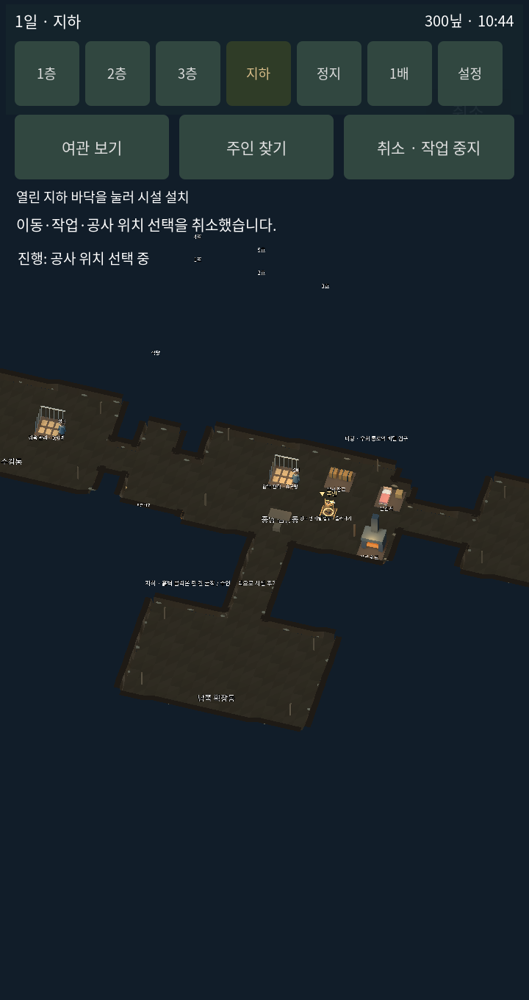
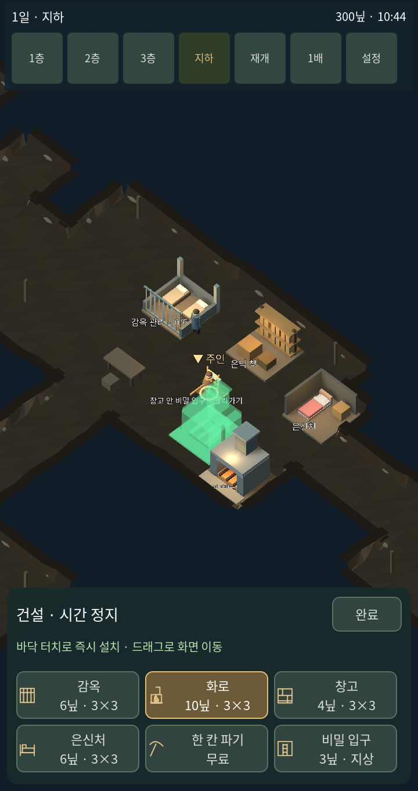
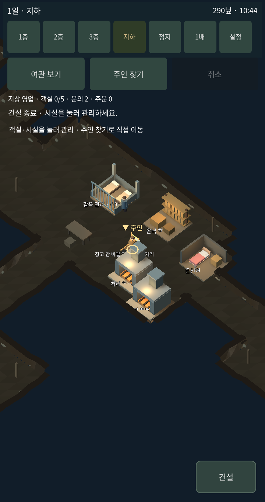

# v1.8.2 건설과 관리 시점

이번 범위는 건설 조작과 지하 카메라다. Prison Architect 전체의 시뮬레이션·UI·소스를 복제한 버전은 아니다.

## 기준 자료

- [Prison Architect 공식 소개](https://www.paradoxinteractive.com/games/prison-architect/about): 시설 배치와 동선, 직원, 수감자 일과가 연결된 관리 게임.
- [Prison Architect 2 개발진 — Building Tools](https://www.paradoxinteractive.com/games/prison-architect-2/news/feature-highlight-building-tools): 단순한 건물 도구, 여러 층, 출입 규칙. 원작 1편과 2편 자료를 혼동하지 않도록 구분한다.
- [Prison Architect 2 개발진 — Rooms & Objects](https://www.paradoxinteractive.com/games/prison-architect-2/news/feature-highlight-rooms-objects): Quick Builds와 Cloning으로 완성된 방을 연속 배치하는 방식. 이번 시설 선택·반복 배치의 기준이다.

## 적용 규칙

| 조작 | 이번 구현 |
|---|---|
| 건설 진입 | 오른쪽 아래 건설 버튼, 중첩 메뉴 생략 |
| 시설 선택 | 6개 큰 아이콘 버튼, 가격과 크기 표시 |
| 위치 지정 | 실제 설치 모델과 같은 반투명 모형, 셀 맞춤 |
| 설치 판정 | 3×3 열린 바닥, 시설 겹침, 입구 접근, 비용 검사 |
| 배치 | 바닥 한 번 터치, 즉시 설치·한 번 결제, 선택 유지 |
| 굴착 | 열린 바닥에 맞닿은 흙을 한 번 터치해 한 칸 무료 확장 |
| 비밀 입구 | 지상 빈 바닥 지정, 즉시 설치, 3닢 |
| 관리 시점 | 지하 기본 배율 48→24, 건설 21, 플레이어와 독립된 카메라 |
| 화면 이동 | 바닥 드래그, 두 손가락 확대·축소; 드래그 종료는 설치하지 않음 |
| 시간 | 건설 중 정지, 완료 시 이전 상태로 복귀 |
| 종료 | 큰 완료 버튼, 상단 취소도 지원 |

원작의 인부 공사 대기 대신 이 프로토타입은 즉시 설치로 난이도를 낮췄다. 굴착 또한 실제 캐릭터의 곡괭이 애니메이션을 기다리는 작업에서 관리 화면의 즉시 굴착으로 바꿨다. 시설의 통행 충돌을 세밀한 가구 단위로 재현하는 단계까지는 포함하지 않는다.

## 실제 화면

같은 720×1360 화면, 같은 게임 시각, 같은 초기 시설과 주인 위치에서 촬영했다. 이전 화면은 편집 전 보존본이다. 변경된 카메라 배율과 시설 모형, 건설 도구가 비교 대상이다.

| 변경 전 | 변경 후 |
|---|---|
|  |  |

시설 모형은 설치 상태와 미리보기가 같은 코드를 사용한다. 감옥은 석재 바닥과 철창, 화로는 굴뚝과 투입구, 창고는 선반과 상자로 구분했다.

## 범위 확인

건설 터치, 한 번 결제, 중복 거부, 재배치 선택 유지, 한 칸 굴착, 메뉴 입력 차단, 시간 복귀, 취소를 대상으로 12개 항목을 확인했다. 기록: [building-v182-checks.txt](building-v182-checks.txt). 실제 휴대폰에서의 성능 확인은 포함하지 않는다.
