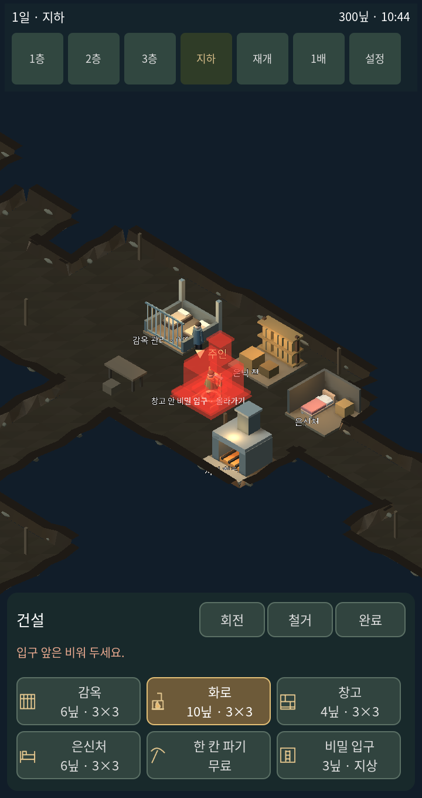
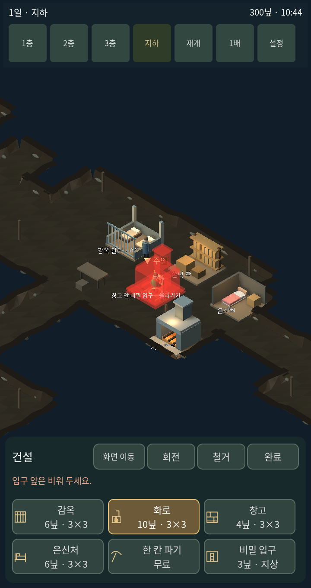
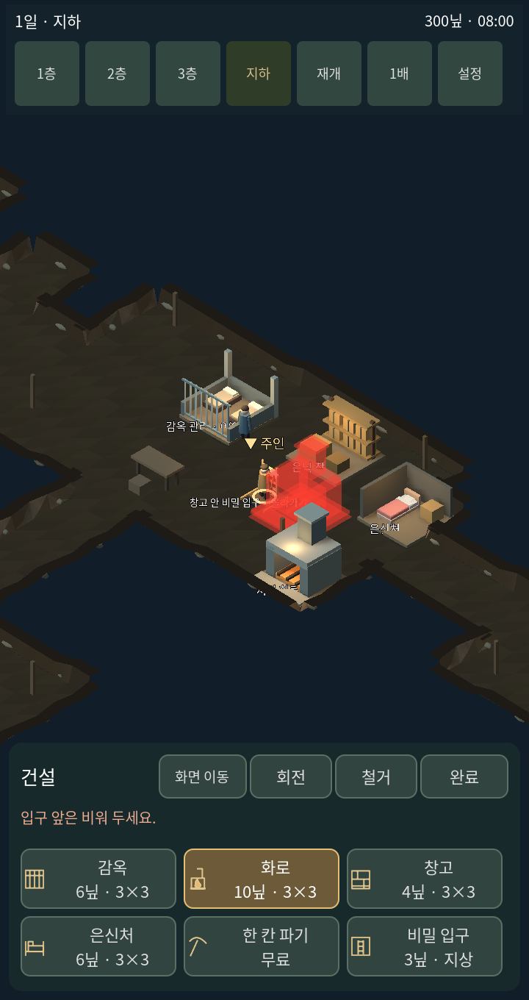

# v1.8.5 사용자 피드백 재현과 조작 수정

이전 테스트가 순서대로 정해진 동작을 실행하는 데 치우쳐 있었다. 이번에는 설치 드래그와 카메라 충돌, 이동 중 다른 명령, 움직이는 대상의 추격을 별도로 재현했다. 게임 전체의 조작 품질이 완성됐다는 뜻으로 테스트 통과를 해석하지 않는다.

## 확인한 문제와 수정

| 문제 | 수정 |
|---|---|
| 설치 모형 드래그와 카메라 팬이 함께 실행됨 | 배치 중 기본 카메라 고정. 별도 화면 이동 모드에서만 팬 허용 |
| 설치 후 같은 모형이 따라다녀 설치물처럼 보임 | 한 번 설치하면 배치 종료, 미리보기 숨김 |
| 안내를 선택해도 주인의 접근을 기다림 | 깨끗한 방은 선택 즉시 객실 등록, 손님 이동만 진행. 더러운 방은 청소 필요 안내 |
| 이동 경로가 상하좌우만 사용 | 지상·객실·지하에서 양옆 장애물이 없는 대각선 이동 허용 |
| 움직이는 목표의 옛 위치까지 걸어감 | 이동 중 0.2초 간격으로 바뀐 위치 재탐색 |
| 접근 지점에 가까운 것을 손님에 가까운 것으로 판단 | 실제 대상과의 거리를 확인해 행동 시작 |
| 도망가는 손님은 붙잡기 자체를 거부 | 떠남/탈출 상태도 실제 퇴장 전까지 추격·붙잡기 허용 |
| 잡는 동작을 기다리다 목표가 다시 멀어짐 | 가까이 도달한 붙잡기는 즉시 완료 |
| 지하 전환 직후 숨겨질 1층 UI가 터치 가로챔 | 현재 층·건설 모드를 입력 판정에서 확인 |

대각선 이동은 장애물 코너를 자르는 모드를 사용하지 않는다. 방 안내는 예약 및 객실 사용 상태를 바로 바꾸지만 손님이 객실까지 순간이동하는 것은 아니다.

## 재현 기록

[수정 전](controls-v185-before.txt)에서 카메라 드래그, 안내 대기, 대각선 경로, 이동 대상 추적이 실패하는 것을 먼저 확인했다. [수정 후](controls-v185-after.txt)는 같은 재현과 실제 도주 대상 붙잡기, 명시적 카메라 이동을 확인한다.

[건설 재확인](controls-v185-building.txt), [기존 재고·이동 통합](controls-v185-integration.txt), [렌더러 화면 터치](controls-v185-touch.txt) 기록을 함께 남긴다. 터치 테스트에는 걷는 도중 접수 버튼을 누르고 추천 방을 안내해 주인 이동 없이 등록되는지 확인하는 흐름을 추가했다. 실제 휴대폰 하드웨어 시험은 아니다.

## 같은 조건의 실제 게임 화면

| 수정 전 | 수정 후 |
|---|---|
|  |  |

아래 두 장은 같은 실행에서 배치 모형을 드래그하기 전후다. 드래그하는 동안 카메라 변환이 동일한지 함께 검사했다.

| 드래그 전 | 드래그 후 |
|---|---|
|  |  |
