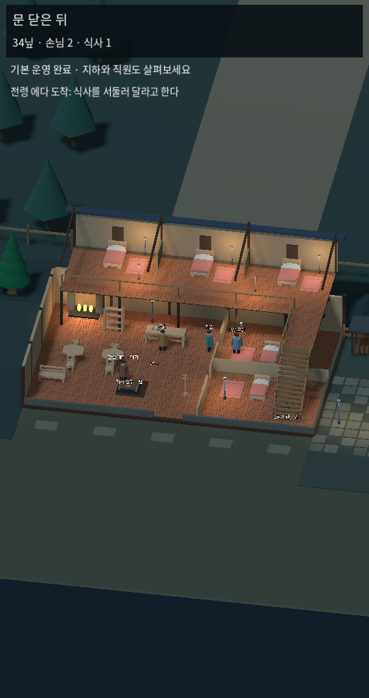
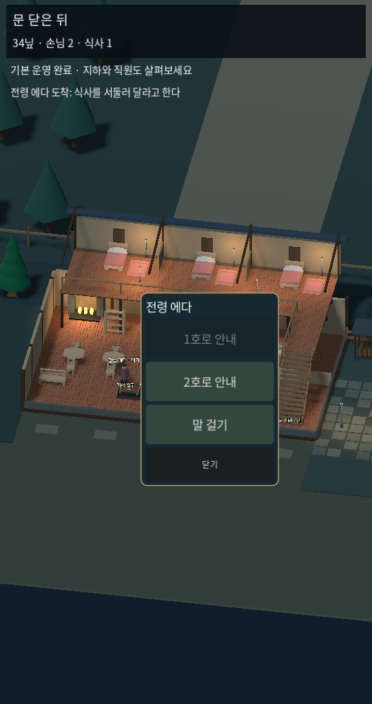
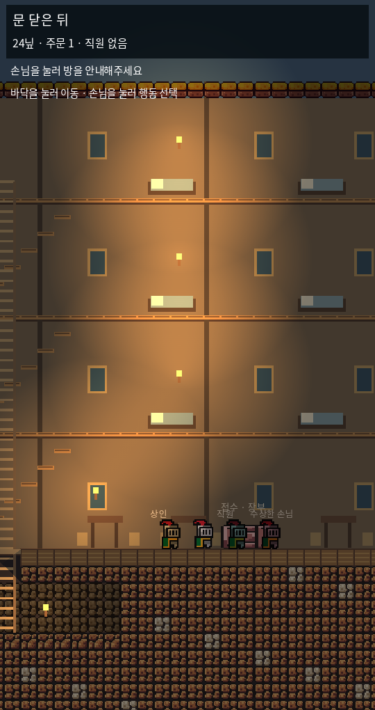
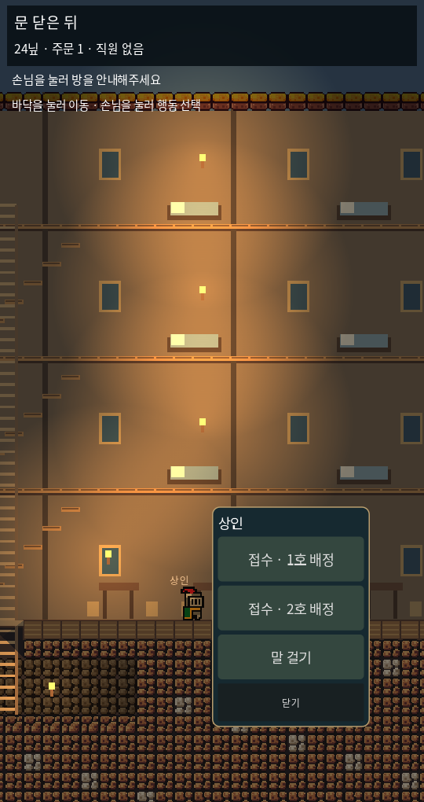

# 1.1 — 직접 접객과 쉬운 첫 영업

[3D 우선 플레이](https://kkhkkh20-bit.github.io/after-hours-inn/?v=easy11) · [2D 비교](https://kkhkkh20-bit.github.io/after-hours-inn/sideview/?v=easy11)

사용자 선택에 따라 로우폴리 3D를 우선한다. 양쪽 모두 바닥 클릭 이동, 사람 클릭 → 사람 옆 행동 목록(B안), 단순 사물의 짧은 행동 목록을 적용했다. 상단은 상태만 표시하며 고정 하단 행동판·대사·장부 버튼을 없앴다. 운영 안내/저장/화면 설정은 접수대 또는 주인을 누르면 열린다. 메뉴 바깥 바닥을 누르면 메뉴를 닫으면서 바로 이동한다. 지하 주인 메뉴의 구금칸과 경비 인물 메뉴의 조사·뇌물도 연결했다.

## 처음 하는 순서

1. 손님이 들어오면 누르고 1호/2호를 고른다. 주인이 자동으로 다가가 그 손님을 접수한다. 접수대에 줄을 세우지 않는다.
2. 묵는 손님 → 식사 내어주기. 3D는 준비·운반·전달까지 이어지고, 2D는 접근 후 간략 제공한다.
3. 식사 1회 후 직원 관련 기능을 소개하고, 3회 후 손님 메뉴에 위험 행동을 표시한다.
4. 지하 덮개 → 내려가기/이동. 3D 흙벽 → 여기 파기(4초). 초기에는 도구 종류를 고르는 메뉴를 줄였다. 2D는 묻힌 흙 클릭 자동 곡괭이와 접근 채굴을 유지한다.
5. 처음에는 4분 사건 카운트다운이 진행되지 않는다. 식사 3회 후 장부에서 첫날 밤 사건을 선택해 시작할 수 있다. 저장에도 초반 운영 상태를 남긴다.

## 자연스러운 방문: 현재 구현과 다음 단계

3D 새 시작: 첫 손님은 마당에서 안으로 걸어와 홀의 정해진 위치에 머문다. 초기 미접객 손님은 최대 1명이며 식사 1회 이후 최대 2명이다. 다음 방문은 48~66초 간격의 시제품 규칙이며, 미접객 손님/객실 수용량에 따라 늦춘다. 대기 위치는 인물별로 바뀌고 귀가는 마당 문까지 걸어간다. 이는 아래 게임의 실제 도착 간격을 복제한 수치가 아니다.

2D 새 시작: 첫 손님은 4초 후 입구에 나타나 홀로 걸어오며 두 번째 손님은 52초 이후 수용 상황에 맞춰 들어온다. NPC는 실제 중력·점프·사다리 경로로 객실까지 이동한다. 아직 식탁에 앉기, 식사 동작, 대화하는 손님 무리, 완전한 일상 스케줄은 없다.

## 이동과 공간

3D 주인 기본 경로 이동 1.7배, 목표 바닥 표식, 계단 도착 후 자동 층 전환과 선택 위치까지 계속 이동, 한 손가락 화면 끌기·두 손가락 확대/축소. NPC 시간·영업 시간은 함께 가속하지 않는다. 2D 주인 달리기 300px/s, 손님은 52% 속도로 이동하며 점프·사다리를 자동 이용한다.

3D는 주변 길·나무·울타리와 마당 바닥을 보완했다. 난로·목재·침대·깔개·등불로 여관을 읽게 하고 기본 화면은 지상을 보여준다. 2D는 지상 여관을 넓히고 초기 지하를 얕은 창고로 줄였다. 현재 2D 상층의 여분 객실은 확장 시스템이 완성된 것이 아니다.

화면은 재현 가능한 대표 상태를 엔진에서 설정해 캡처했다. 컨셉 이미지나 사용자 실기기 플레이 캡처가 아니다.

## 레퍼런스 적용 판단

- Travellers Rest: 개발사 공식 소개의 음식·음료·숙박 운영, 가구 배치와 평판에 따른 선택지 확장을 참고한다. 처음에 일상 운영을 익히고 나중에 늘어나는 구조가 대상이다. [개발사 설명](https://travellers-rest.itch.io/travellers-rest)
- Tavern Keeper: 공식 소개의 자유로운 꾸미기, 난도 조절과 부담 없는 Relaxed 운영, 소음·청결·질병 등이 얽히는 시스템을 참고한다. 우리는 쉬운 시작에서 나중에 위험을 늘리는 근거로 사용한다. [개발사 Steam 설명](https://store.steampowered.com/app/436780/Tavern_Keeper/)
- 스크린샷만으로 방문 간격·손님 AI를 확인했다고 주장하지 않는다. 대기열을 줄이고 마당 → 홀 → 객실로 나누는 동선은 이번 자체 구현이며, 실제 앉기·주변 살피기·인물 간 교류는 다음 PoC다.

## 검증과 한계

3D 기존 146개 시뮬레이션, 32개 실제 클릭/터치·이동·접객·굴착·저장·쉬운 시작 검사 통과. 2D 31개 영업 규칙+17개 지형 규칙과 실제 물리 이동·클릭·특정 손님 접수·객실 도착 검사 통과. 두 버전 각 23개 사건 규칙, 실제 첫날 밤 완주 통과. Web·Windows export와 Linux Godot 실제 렌더링을 확인한다. 모바일 실기기/Windows 직접 실행과 프레임률 검증은 남아 있다.

여관 증축·손님 간 음모·살인·시신 처리·세력 임대·전체 캠페인은 이번 완료 범위가 아니다. 캐릭터/소리/미술은 시제품이다. 굴착은 격자 단위를 연속 흙벽 외형으로 보여주는 기존 방식이다.
