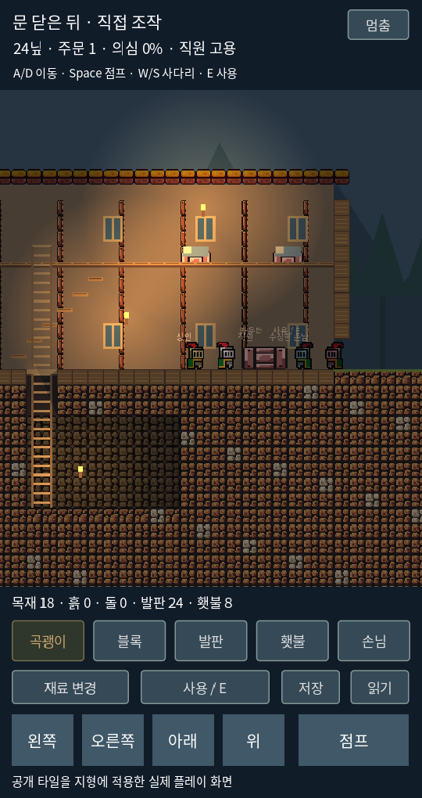
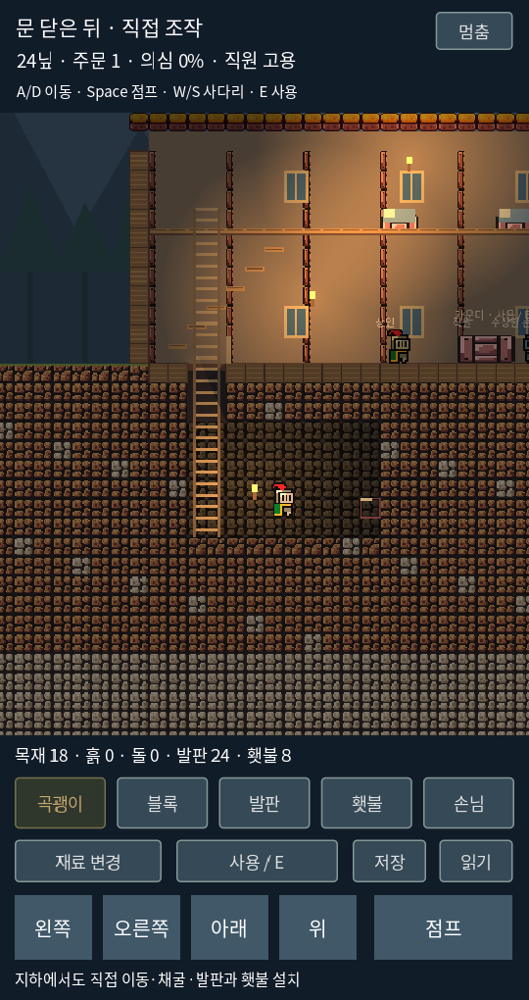

# 2D 직접 조작 실험 0.2 — 걷기·점프·채굴·설치

2026-10-17. 사용자 요청에 따라 클릭 자동 이동에서 직접 조작으로 바꿨다.

[실행](https://kkhkkh20-bit.github.io/after-hours-inn/sideview/) · [이전 2D 0.1 기록](sideview-poc.md) · [기존 3D](https://kkhkkh20-bit.github.io/after-hours-inn/)

이 버전은 테라리아의 원본 코드나 원본 에셋을 사용하지 않는다. 이전에 반입한 Brackeys CC0 팩을 사용하며, 이번에는 흙·돌 타일을 실제 지형 전체에 적용했다. 움직임과 공간 조작의 참고 방향이 테라리아라는 뜻이다. 원작과 동일한 조작감이나 모든 기능의 구현을 주장하지 않는다.

## 실제 실행 화면

Godot 실행 캡처다. 화면을 비교하기 위해 직원 고용 후 일시정지한 상태를 설정했다. 일반 시작은 직원 미고용이다. 지하 캡처는 시작 지하실에 주인을 놓은 상태다.

## 바뀐 것

- CharacterBody2D의 실제 충돌·중력·가속·감속. 좌우 이동, 점프, 버튼을 일찍 놓으면 낮은 점프, 짧은 점프 입력 버퍼와 발판 가장자리 유예.
- 공중에서 조작 가능. 일방향 발판은 아래에서 통과해 올라가고 아래 조작으로 내려온다.
- 사다리는 위/아래로 직접 이동. 지하 덮개를 먼저 열어야 통과한다.
- 카메라는 주인을 따라간다. 전체 건물을 고정 표시하는 이전 시점과 다르다.
- 84×54 격자의 제한된 지도. 지하를 가로뿐 아니라 아래·위 방향으로도 파고 연결할 수 있다.
- 가까운 타일을 누르고 있으면 채굴. 흙·목재·발판 약 0.48초, 돌 약 0.85초. 회수한 자원은 인벤토리에 들어간다.
- 흙·돌·목재 블록 재설치, 발판과 횃불 설치. 거리·연결 면·자원·인물 겹침 제한을 적용했다.
- 채굴에 따라 실제 충돌 지형도 바뀐다. 덩어리를 지우는 6회 한도 확장이 아니다.
- 지형·인벤토리·주인 위치·여관 돈/주문/직원·덮개·손님의 기절 상태와 주요 타이머 저장.

## 조작

| 행동 | PC | 터치 |
|---|---|---|
| 이동 | A/D 또는 좌우 방향키 | 왼쪽/오른쪽 누르기 |
| 점프 | Space, 길게 누르면 더 높이 | 점프 누르기 |
| 사다리 | W/S 또는 위아래 방향키 | 위/아래 누르기 |
| 발판 내려가기·느리게 걷기 | S | 아래 |
| 도구 선택 | 1~5 또는 툴바 | 곡괭이/블록/발판/횃불/손님 |
| 채굴 | 곡괭이 선택 후 가까운 타일을 왼쪽 버튼으로 누르기 | 가까운 타일을 누르고 있기 |
| 설치 | 블록/발판/횃불 선택 후 가까운 빈칸 클릭 | 같은 방식으로 누르기 |
| 설치 재료 변경 | 재료 변경 버튼 | 재료 변경 버튼 |
| 사용 | E | 사용 / E |
| 손님 선택 | 손님 모드에서 인물 클릭 | 손님 모드에서 인물 누르기 |

선택한 타일이 너무 멀면 빨간 테두리다. 커서가 인물 몸 위에 있거나 주변 블록과 연결되지 않으면 설치할 수 없다. 횃불은 가까이 가서 E로 회수할 수 있다.

## 먼저 해보기

1. 좌우 이동과 짧게/길게 누르는 점프를 비교한다. 발판에 올라갔다가 아래 버튼으로 내려온다.
2. 카운터 근처에서 E를 누르면 8닢으로 직원을 고용한다. 고용 후 E는 주문이 있을 때 식사를 제공한다.
3. 왼쪽 사다리와 지하 덮개에 접근해 E로 연다. 아래 버튼으로 지하실까지 내려간다.
4. 곡괭이로 벽이나 바닥을 누르고 채굴한다. 바로 아래를 파면 주인도 떨어지므로 발판이나 사다리 쪽으로 돌아갈 경로를 남긴다.
5. 발판·블록을 놓아 돌아올 길을 만든다. 횃불을 설치해 어두운 곳을 밝힌다.
6. 덮개를 열고/닫은 상태에서 채굴할 때 직원의 청취 반응을 비교한다.

## 여관과 잠입 연결

돈·직원 고용·자동 접객·급여·반복 주문을 직접 조작 버전에 연결했다. 물건을 사용하려면 실제로 가까이 가야 한다. 등불은 고정 토글 대신 회수/재설치하는 횃불 방식이다. 빛과 방향·거리·실제 고체 지형의 시선 차단으로 손님 식별을 판정한다. 기절한 손님은 느리게 운반하고 점프 높이도 줄어든다.

손님 모드에서 인물을 선택하고 가까이 가서 E를 누르면 접근을 시도한다. 정면에서 눈치채면 실패하고 의심이 오른다. 뒤쪽·어두운 틈에서는 기절시킬 수 있고 목격자가 있으면 의심이 더 오른다. 선택은 다른 도구 모드로 바꾸면 해제된다. 경비는 아직 75초마다의 결과 이벤트다.

## 검증

- 이전 2D 규칙 검사 31개와 새 지형 검사 17개 통과.
- 실제 Godot 물리 프레임에서 걷기·점프·중력 착지, 근거리 채굴·자원 회수·지형 저장 왕복을 확인.
- 네이티브 ScreenTouch 이벤트 2개로 이동/점프 동시 누르기, 점프만 떼었을 때 이동 유지, 마지막 손가락을 뗐을 때 이동 해제를 확인.
- 기존 3D 146개 규칙 + 45개 포인터 검증을 같은 빌드에서 유지한다.
- Linux 렌더 화면을 직접 확인하고 Web/Windows 내보내기를 실행한다. 실제 폰과 Windows에서의 조작감·성능 검증은 별도다.

## 현재 한계와 다음 범위

아직 테라리아의 모든 기능이 있는 게임이 아니다. 장비·무기·전투·제작대·아이템 드롭 오브젝트·상자·대형 절차 생성·물·배선·멀티플레이는 없다. NPC는 홀에서 제한적으로 움직이며, 주인처럼 점프·채굴하거나 계단을 따라 객실 생활을 하지는 않는다. 바닥이 없어지면 멈추지만 고체를 쌓아 진로가 막힌 상황을 완전한 경로 탐색으로 해결하지는 않는다. 이번 직접 조작 화면에서는 객실 재배정 UI를 연결하지 않았다. 이전 0.1 장면과 소스는 유지한다.

앞으로 테라리아에서 우선 참고할 것은 도구/인벤토리/제작대/문·가구·저장 상호작용이다. 방대한 장비 성장과 보스전보다 여관의 접객·정보·위험한 손님·비밀 공간이 중심이 되어야 한다는 제작 제안이다.

현재 캐릭터는 공개 기사 스프라이트이고 실제 역사 여관의 최종 미술이 아니다. 흙과 돌의 원본 도트 타일을 확대해 사용하며 목재·가구·배경 일부는 코드로 그렸다. 공개 에셋 조건은 `prototypes/sideview/assets/THIRD_PARTY.md`를 따른다. 새 구매나 회원가입은 없다.
