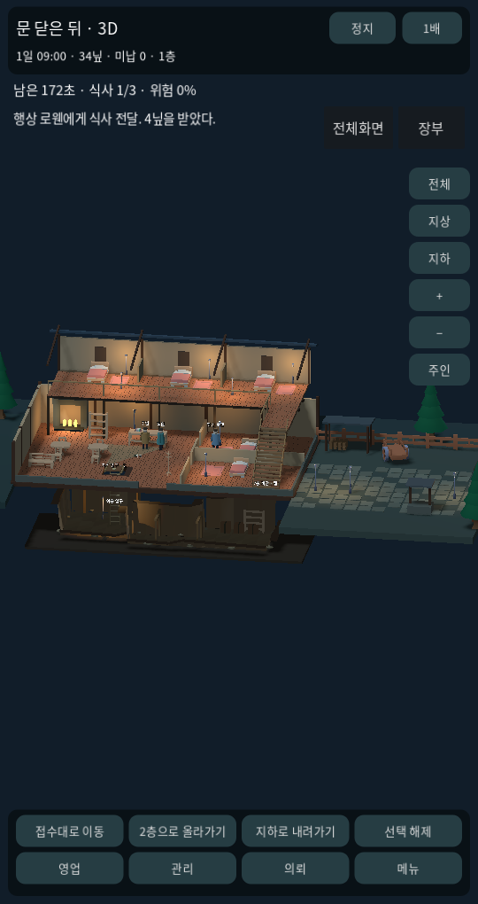
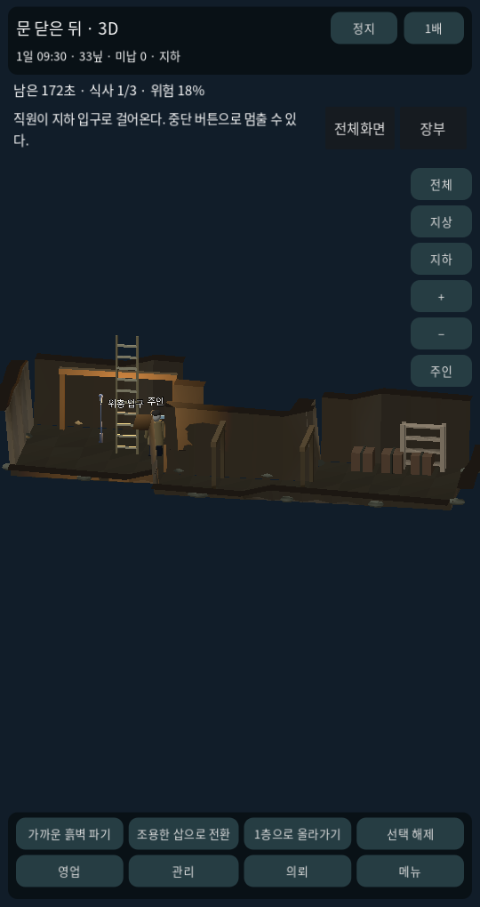
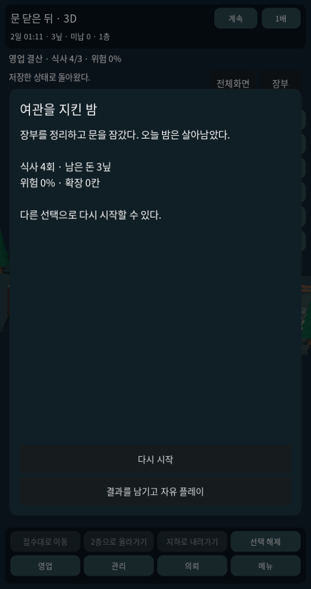
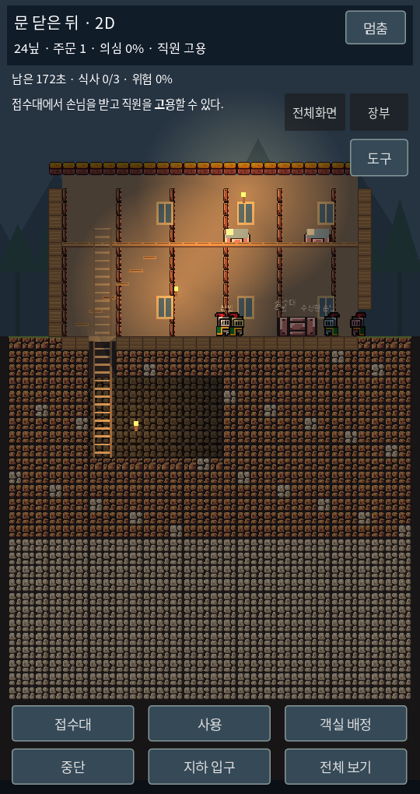
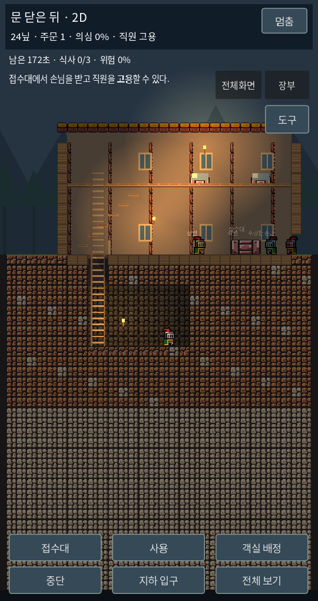
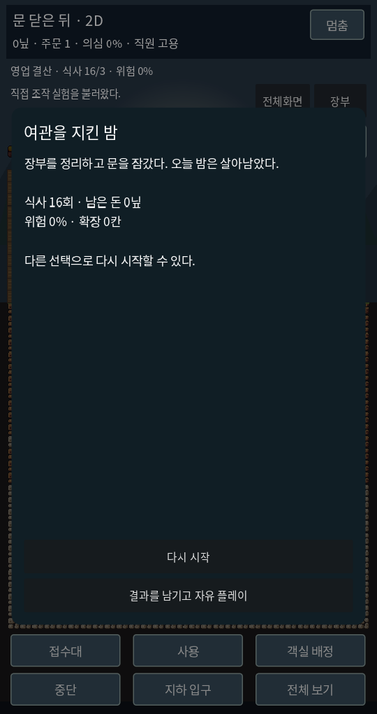

# 第一夜 / 첫 번째 밤 — 3D·2D 비교판

2026-10-17. 두 프로젝트 모두 720×1360 기준 세로 화면이다. 하단 고정 대사·안내판을 제거했다. 행동 결과만 상단에 잠시 표시한다. 브라우저 화면을 게임 캔버스로 사용하며 전체화면 버튼도 제공한다. 브라우저/기기의 전체화면 지원 여부는 다를 수 있다.

[3D 실행](https://kkhkkh20-bit.github.io/after-hours-inn/?v=episode1) · [2D 실행](https://kkhkkh20-bit.github.io/after-hours-inn/sideview/?v=episode1)

## 플레이 목표

문을 연 뒤 실제 플레이 시간 4분 안에 식사 3회와 임대료 36닢을 준비한다. 직원이 제공한 식사도 인정한다. 마지막 1분에 접수대로 돌아와 장부에서 납부한다. 장부를 열거나 일시 정지하면 제한 시간도 멈춘다. 3D의 3배속은 사건 시간도 3배 빠르다.

- 40초: 보호비 요구. 8닢 지급 / 4닢으로 신고 / 밀수 협력으로 16닢 수령 / 거절. 무응답은 거절로 처리한다.
- 125초: 장부 조사. 장부 공개 / 12닢 뇌물 / 지하 용도 변명. 숨긴 사람·열린 덮개·누적 위험이 결과에 반영된다. 무응답도 위험을 높인다.
- 180초: 접수대에서 임대료 납부 가능. 식사 횟수와 경비 대응 조건을 확인한다.
- 240초: 미납이면 실패. 위험 100%면 체포. 생존·불안한 생존·밀수의 대가·체납·체포의 결말이 있다.
- 결과에서 재시작하거나 저장한 결과를 남기고 자유 영업을 계속한다. 사건과 남은 시간도 저장된다.

## 3D 조작

바닥 탭으로 이동, 화면 끌기로 둘러보기. 하단 영업에서 객실 배정·식사 준비, 관리에서 직원 고용·도구 수리·덮개/등불. 식사를 들고 손님을 선택해 전달한다. 지하에서 흙벽을 눌러 접근·굴착한다. 제압·운반·구금·목격·직원 확인·실제 경비 동선 등 기존 0.9 시스템을 유지한다. 장부는 이번 단편의 사건과 결산이다. 기존 의뢰 메뉴와는 별개이다.

## 2D 조작

바닥 탭으로 이동하며 점프와 사다리는 자동 이용한다. 접수대 버튼으로 이동한 뒤 사용 버튼으로 직원 고용·식사 제공. 직접 서빙은 4닢, 직원은 12초마다 최대 한 주문을 맡아 순수입 2닢이며 90초마다 임금 6닢이 든다. 객실 수입과 직접 서빙을 함께 써야 여유가 생긴다. 객실 배정 버튼에서 1호/2호를 지정한다. 손님을 탭하면 선택되며 기절 시도·운반이 가능하다. 도구 창에서 굴착·벽·발판·횃불을 선택한다. 묻힌 흙/돌은 맥락 채굴을 지원한다. 덮개 열기와 굴착 동선은 실제 충돌 지형에 반영된다.

2D 객실은 예약·숙박비·퇴실 시간·청소의 간단한 장부 상태다. 손님이 실제로 2층까지 경로를 따라 입실하는 기능은 아직 없다. 손님은 주로 1층에서 움직인다. 3D의 구금/의뢰 전체 기능을 2D에 동일하게 옮긴 것은 아니다.

## 실제 엔진 화면

아래는 이미지 생성 시안이 아니다. Godot 실행 화면을 저장했다. 영업/지하 화면은 대표 상태를 배치한 캡처이고, 결말 화면은 실제 영업 규칙을 진행하는 검증의 결과다.

## 검증과 완성도

두 버전의 단편 규칙·장부 UI는 동일한 원본을 사용하고 CI에서 파일 일치를 검사한다. 각 23개 분기 검사, 3D 146개 시뮬레이션·45개 포인터/터치 검사, 2D 31개 운영·17개 지형 검사, 실제 물리/마우스/터치 경로 이동 검사를 통과했다. 별도 완주 검증에서 실제 숙박 접수→직원 서빙 수입→사건 대응→임대료 납부→결말→저장/불러오기→자유 플레이를 두 버전 모두 실행한다. 세로 화면과 기존 가로 포인터 회귀도 확인한다.

추가 구매는 없다. 기존 Godot와 공개 모델/CC0 이미지·OFL 글꼴을 사용한다. Web·Windows 빌드를 생성하지만 실제 Windows 기기나 Android/iPhone에서의 성능·터치·전체화면은 이 환경에서 확인하지 못했다. 스토어 등록/결제는 하지 않았다.

상용 완제품은 아니다. 첫 번째 밤의 시작과 결말을 갖춘 비교판이다. 사건 일부는 장부 선택과 상태 판정이며 모든 사건이 물리 NPC 행동으로 연출되지는 않는다. 장기 캠페인·최종 미술·손님별 깊은 AI·다양한 범죄/세력 시스템·상점·모바일 제품 QA가 남아 있다. 현재 구매 의향에 대한 답은 아직 아니오다. 세로 화면의 공간 밀도와 제작 비용을 고려하면 지금은 2D를 우선 제작하는 편을 추천한다.
