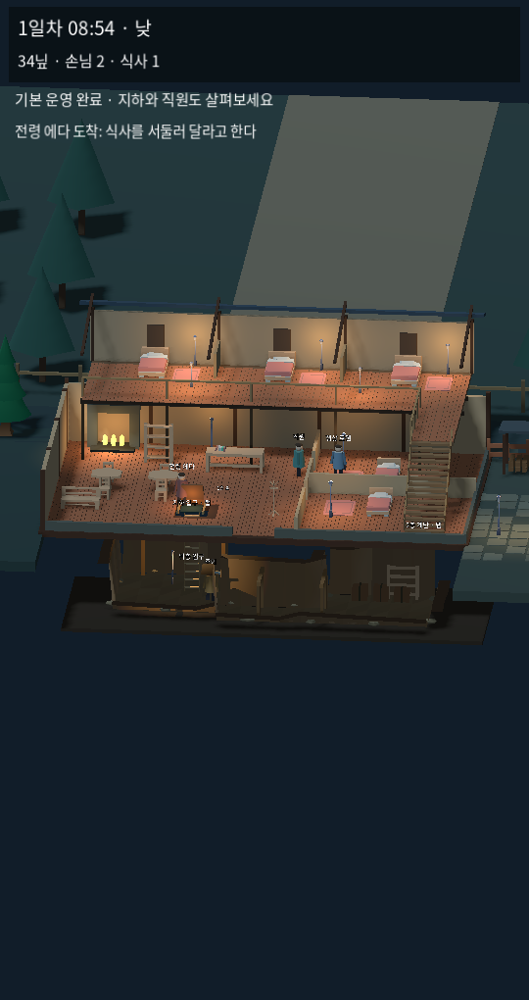

# 1.2 — 다시 쓰는 객실·식사 손님·하루와 전체 단면

3D 우선 수정. 기존 1.1 조작 기록보다 이 문서를 우선한다. 2D는 비교판을 유지하며 이번 손님·달력·전체 시점 구현은 3D 범위다.

## 확인한 문제와 수정

- 객실은 퇴실 후 청소가 필요해지지만 이전 안내 메뉴는 해당 방을 비활성화했다. 빈방이 더러우면 `정리 후 안내`를 누를 수 있다. 주인이 객실 정리 4초 → 선택한 손님에게 접근 → 재접수를 이어서 한다. 청소 명령도 근처의 다른 상호작용을 호출하는 대신 해당 객실을 직접 처리한다.
- 사람의 화면 중앙 한 점을 검사하던 방식을 발~머리 선분과 여유 폭으로 바꿨다. 누르는 순간의 손님/주인을 기억해 손을 떼는 동안 움직여도 같은 대상을 선택한다. NPC를 가구보다 먼저 검사한다. 메뉴 위치는 열린 동안 고정해 버튼이 도망가지 않는다.
- 지하에 내려가면 지상 전체가 사라지던 자동 필터를 없앴다. 기본은 2층·1층·마당·지하 동시 보기이며 더 낮은 사선 시점으로 단면을 보여준다. 지하에서 지상 손님을 클릭해 서빙하면 주인이 입구를 거쳐 올라가 처리한다. 원거리 즉시 실행은 하지 않는다.

## 하루와 손님

게임 24시간 = 현실 8분. 새 시작은 1일차 08:00. 20:00부터 밤, 00:00에 날짜가 바뀐다. 숙박 손님은 다음 날 08:00 퇴실한다. 실제 하루 길이와 숙박·임금·임대료·징수원이 같은 분 단위 기준을 사용한다. 직원 급여 20시, 기존 임대료 2일차 09시/징수원 12시 기준을 이어 쓴다. 장부에서 선택하는 4분 사건 도전은 운영 달력과 별개다. 낮/밤은 현재 HUD 시간 구분이며 완성된 태양·날씨·폐점 시스템은 아니다.

숙박 손님: 빈 객실 선택 → 숙박료 → 객실 이동 → 식사/체류 → 다음 날 08시 퇴실 → 정리 후 재접수.

식사 손님: 마당에서 홀로 이동 → 객실 없이 주문 → 식사 제공/4닢 결제 → 8초 뒤 귀가 시작. 서비스가 없으면 90초 대기 후 떠난다. 숙박 손님과 섞여 방문하며 두 객실이 차 있어도 식사 손님은 받을 수 있다. 식탁에 앉는 완성 애니메이션은 아직 없다.

## 실제 시점

Linux Godot에서 재현 가능한 대표 상태를 구성해 실제 렌더링한 시점 검증 화면이다. AI 콘셉트 이미지나 휴대폰 실기기 캡처가 아니다. 기본 카메라와 실제 층 표시 규칙이 동일하다.

## 검증

3D 입력·흐름 60개 검사 통과. 기존 43개에 양쪽 객실의 퇴실/청소/두 번째 손님 접수, 08시·20시·자정, 다음 날 퇴실, 객실 없는 식사·서빙·귀가, 움직이는 손님의 누름/뗌 사이 선택 유지, 메뉴 고정, 지하에서 지상 손님 클릭 → 실제 복귀 → 서빙과 동시 표시를 추가했다. 기존 146개 시뮬레이션, 두 버전 사건 규칙·단편 완주, 2D 실제 물리·탭 검사를 다시 실행한다. 실기기 터치/프레임률과 Windows 직접 실행은 미확인이다.

여관 증축·손님 간 음모·완성 동작·시신 은닉/처분·전체 캠페인은 후속이다. 이번에는 기존 운영의 반복과 선택 안정성을 우선한다.
