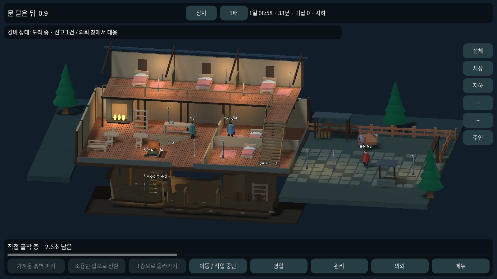
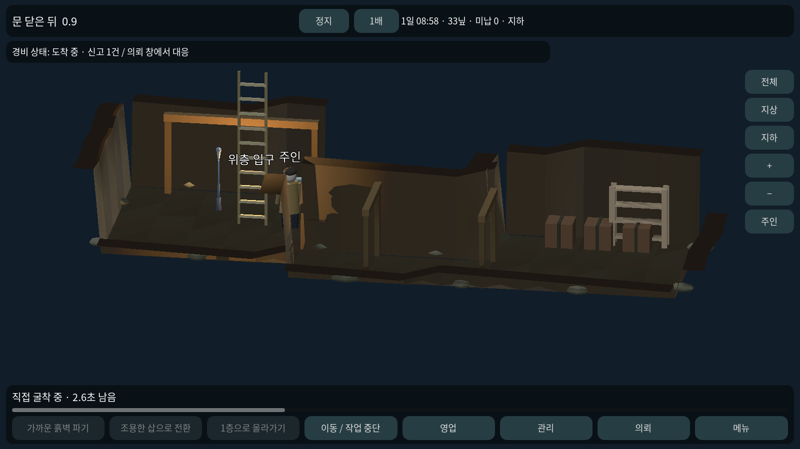
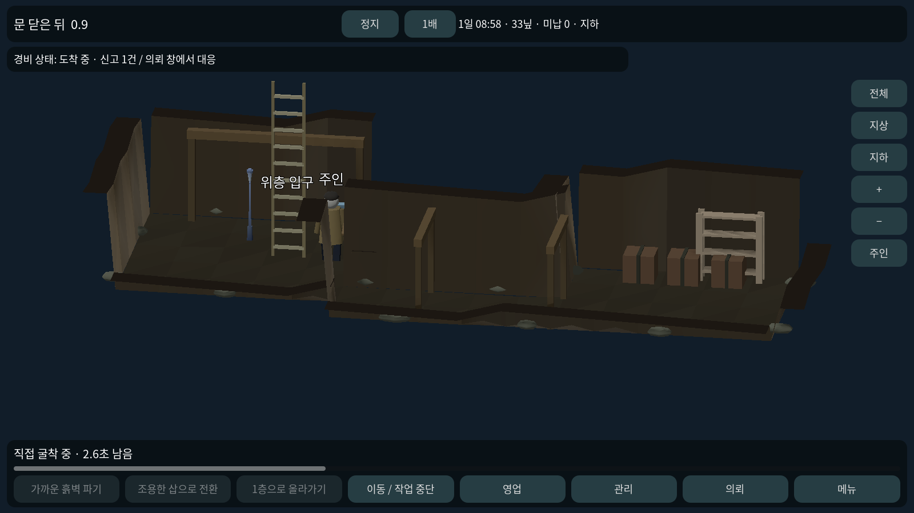

# 0.9 — 가로형 여관 단면 플레이 초안

사용자가 고른 넓은 가로형 콘셉트를 기존 Godot 4.7.2 프로젝트에 옮긴 실행 가능한 시제품이다. 이미지 시안의 장식·재질·인물 품질을 모두 구현한 상태는 아니다.

## 화면과 공간

- 기본 1600×900 가로 화면, 전체 보기에서 주인을 따라가지 않는 사선 카메라.
- 2층 다락과 복도, 1층 홀, 오른쪽 마당, 여관 아래 지하를 같은 3D 장면에 표시한다.
- 오른쪽 전체/지상/지하 버튼은 보기만 바꾼다. 주인의 실제 위치나 층을 바꾸지 않는다.
- 화면 끌기로 둘러보기, +/− 확대·축소, 주인 버튼으로 위치 따라가기를 지원한다. 전체 버튼으로 돌아오면 고정 전체 보기가 된다.
- 마당은 실제 경로 이동 가능하다. 수레·장작 보관소·우물·울타리·출입문을 배치했다.
- 2층은 실제 경사 계단, 난간, 걸어볼 수 있는 다락 공간과 세 개의 침대가 있다. 숙박 배정과 직원 영업은 기존 1층 두 객실에서 처리한다.
- 지하는 실제 표시 높이 -4.2에 있고, 입구 사다리가 위층 덮개와 연결된다. 지상과 지하가 통째로 사라졌다 바뀌는 화면을 기본값에서 없앴다. 지하 층 이동 상태 전환은 즉시이며 사다리 승강 애니메이션은 후속이다.

## 지하 작업과 감각

새 게임은 55칸의 입구 방·연결 통로·창고에서 시작한다. 가장자리의 흙벽을 탭하면 접근 후 도구로 굴착한다. 굴착 범위는 가로 ±22, 세로 ±12까지로 늘려 마당 아래까지 이어 갈 수 있다. 기존 저장에 새 지형을 덮어쓰지 않는다.

큰 흙 정육면체 대신 이어진 바닥과 거친 면의 벽·낮은 앞쪽 단면·돌 조각·목재 지지대로 그린다. 내부 굴착 규칙은 격자이며 완료 시 확장된다. 자유 곡면을 실시간 조각하는 시스템은 아니다.

관리 창에서 지하 등불을 켜고 끌 수 있다. 켜진 등불의 가까운 공간과 열린 통로를 기준으로 NPC가 인물을 식별한다. 꺼진 상태에서는 가까운 접촉 범위 외의 식별을 제한한다. 실제 등불과 그림자도 바뀐다.

입구 근처에서 관리 창의 덮개 버튼으로 열고 닫는다. 덮개를 닫으면 새는 빛이 사라지고 위층에 전달되는 소리가 35%로 줄어든다. 굴착 위치→실제 지하 경로→입구→위층 경로를 따라 거리를 계산한다. 직원의 기존 조사·기억·거부 반응과 연결된다. 나갈 때는 덮개를 다시 연다.

신고를 받은 경비는 마당 문에서 등장해 실제 경로로 접수대에 온다. 기존 기다림·뇌물·지하 수색·적발·벌금 기능을 유지한다.

## 한 판 확인 순서

1. 전체 보기에서 영업 → 1호 배정. 관리 → 직원 고용.
2. 대상 선택을 해제한 뒤 2층으로 올라가기를 누르고 다락 복도를 걸어 본다. 아래의 영업은 계속 진행된다.
3. 1층으로 내려온 뒤 지하로 내려가기를 누른다. 전체 보기에서 주인의 지하 작업과 위층 직원을 같이 본다.
4. 흙벽 탭 또는 가까운 흙벽 파기로 굴착한다. 관리에서 등불과 입구 덮개 상태를 비교한다. 덮개는 입구 가까이에서만 조작된다.
5. 지하 보기로 확대하고 창고까지 걸어 본다. 전체 보기로 돌아와도 주인은 이동하지 않는다.
6. 기존 의뢰·제압·운반·구금·목격·신고를 테스트하면 경비가 마당에서 접근한다. 메뉴에서 저장·불러오기.

기존 저장을 불러오면 이미 판 지형을 유지하므로 새 시작 창고가 자동으로 생기지 않는다. 새 배치 확인은 저장을 불러오지 않은 새 실행에서 한다.

## 실제 실행 화면

세 장은 동일 Godot 게임 상태의 실제 1600×900 렌더링이다. 콘셉트 생성 이미지와 구분한다. 경비 도착 화면은 신고를 발생시킨 재현 시나리오다.

## 검증과 리소스

146개 시뮬레이션 + 45개 실제 포인터/터치 입력 = 191개 통과. 기존 영업·의뢰·구금·조사 회귀와 전체 보기 고정, 마당 이동, 보기/실제 층 분리, 지하 표시 좌표, 등불/덮개 버튼, 소리 감쇠, 암부 식별, 저장 복원, 야외 경비 접근을 확인했다.

기존 엔진·Kenney CC0 모델·글꼴을 재사용했다. 새 구매·별도 API·새 계정은 없다. 건물과 지형 표현을 별도 스크립트로 나눴다. 휴대폰 실기기의 터치감·안전 영역·성능은 확인이 남아 있다. Windows 실행 파일은 CI로 생성하며 이 환경에서 직접 실행하지 않는다.

2층 투숙 AI, 손님 간 사건, 층간 도청·시야, 문 개폐 전체, 완성된 인물 동작·재질·음악, 자유 건축과 완성 캠페인은 후속 범위다. 빛·소리는 거리·통로·입구 상태 기반의 시제품 규칙이다.
