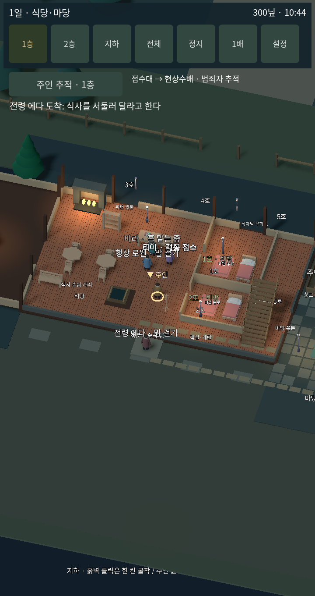
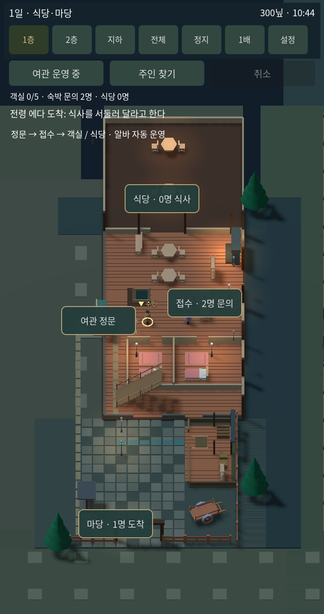
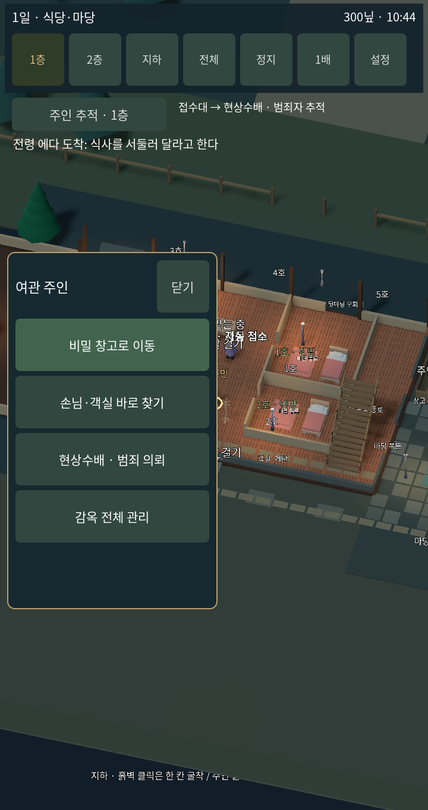
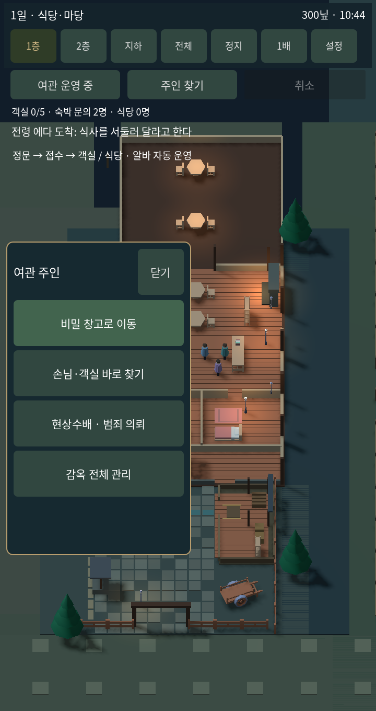
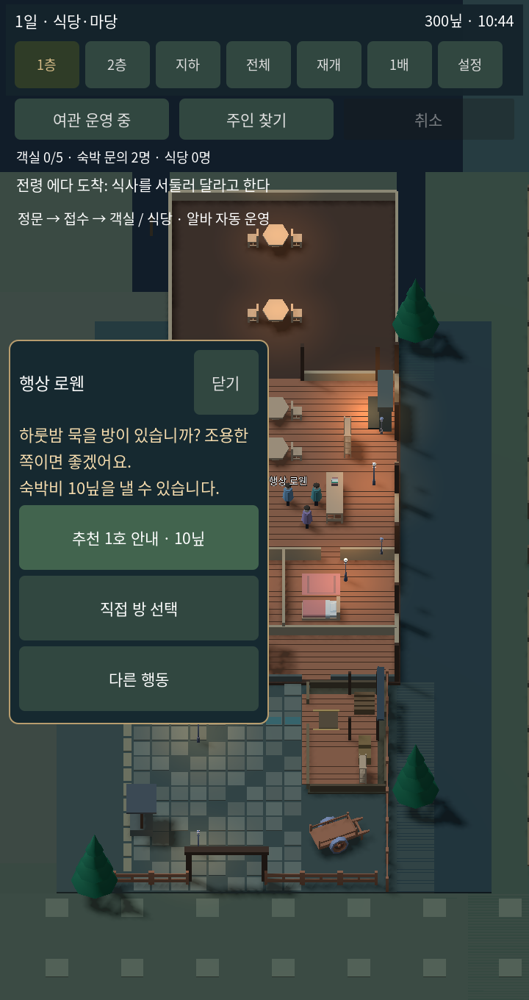
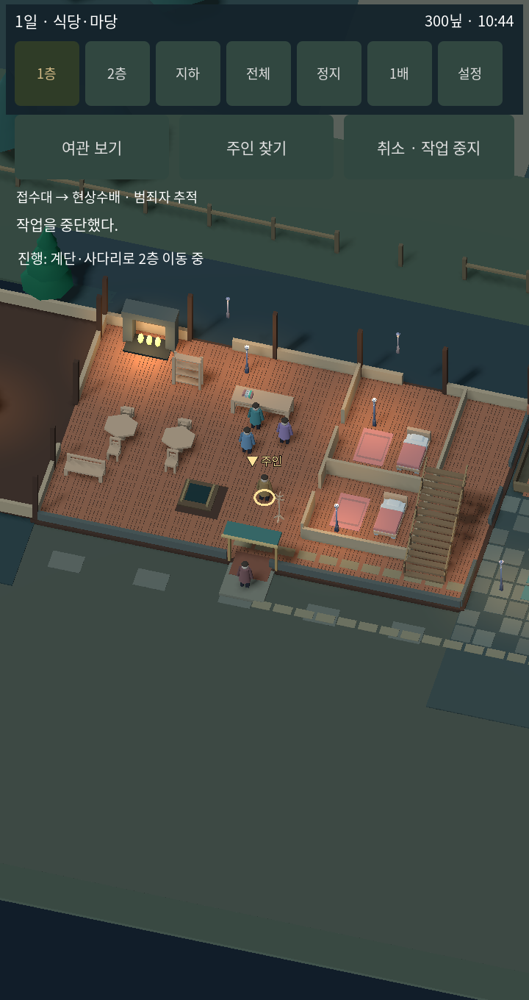

# 1.8.0 모바일 여관 운영과 전후 비교

## 참고한 공식 자료

Hotel Empire Tycoon의 개발사 소개와 Google Play 배포 스크린샷을 확인했다. 스크린샷에서 접수대, 공용 동선, 객실이 구분되는 모습과 시설별 경영 구조를 참고했다. 이미지에서 관찰한 배치는 조작 규칙의 완전한 검증을 의미하지 않는다.

- https://codigames.com/game/hotel-empire-tycoon/
- https://play.google.com/store/apps/details?hl=en&id=com.codigames.hotel.empire.tycoon.idle.game
- Tavern Master 공식 소개: https://untitledstudio.dev/games/tavern-master

우리 게임에는 독립된 미술·맵과 기존 손님 시뮬레이션을 유지하면서, 시설을 바로 선택하는 정보 배치와 안정된 운영 시점을 적용했다. 원작의 소스나 에셋을 가져오거나 원작과 동등한 완성도를 주장하지 않는다.

## 무엇이 바뀌었나

| 부분 | 적용 전 | 적용 후 |
|---|---|---|
| 기본 시점 | 가까운 주인 중심, 옆 마당이 화면 밖 | 세로 운영 구도에 여관·마당 함께 표시 |
| 운영 중 이동 | 이동하면 주인 추적 재개 | 운영 시점 유지, 주인 찾기는 별도 선택 |
| 손님 접근 | 작은 인물과 겹친 이름을 찾아 선택 | 접수·식당·정문·마당 표시를 직접 터치 |
| 일반 손님 | 첫 메뉴에 감옥 행동 혼재 | 요구 확인 후 추천 방·직접 방 선택 우선 |
| 취소 | 작업 문구 아래 취소와 PC 우클릭 보조 | 상단 고정 위치에 터치 취소, 작업 중 활성화 |
| 화면 문구 | 시설 설명·이름·객실 문구가 중첩 | 1층은 선택한 인물 이름과 핵심 구역만 표시 |
| 목표 | 의뢰 문구 우선 | 여관 보기에서는 객실·숙박 문의·식사 인원 우선 |

## 실제 실행 화면 비교

720 × 1360, 새 게임을 약 24초 진행한 상황. 적용 전은 1.7.9에서 실제로 먼저 캡처한 이미지다. 적용 후는 수정한 렌더러 화면이며 합성 시안이 아니다. 동일한 화면 크기와 진행 시간으로 비교했다. WebP는 원본 PNG를 무손실 저장한 문서용 사본이다.

| 적용 전 | 적용 후 |
|---|---|
|  |  |
|  |  |

손님 요구와 추천 방 안내:

모바일 작업 취소 위치:

## 확인과 한계

모바일 운영 집중 진단 19개, 영향받는 층 이동 진단 15개 통과. 화면의 구역 표시를 실제 터치 이벤트로 누르고, 추천 방 예약·취소·화면 고정을 확인했다. 캡처 이미지를 직접 열어 출입구 표시, 문구 겹침, 메뉴 뒤 구역 버튼 숨김을 확인했다. 실제 iPhone/Android 기기를 손으로 조작한 것은 아니므로 물리 기기 체감까지 확인했다고 말하지 않는다.

PC 우클릭은 보조 수단이다. 모바일 주요 행동은 별도 버튼과 한 번 터치로 가능하다. 고정 운영 시점의 공간 배치는 현재 맵을 활용한 것으로, 원작의 그래픽과 맵을 그대로 복제하지 않았다.

이후 UI·카메라·맵 변경에서도 적용 전후 실캡처를 남기도록 루트 AGENTS.md에 작업 규칙을 기록했다.

모바일 기본 터치 버튼과 구역 표시는 720px 기준 높이 88px 이상으로 맞췄다.
