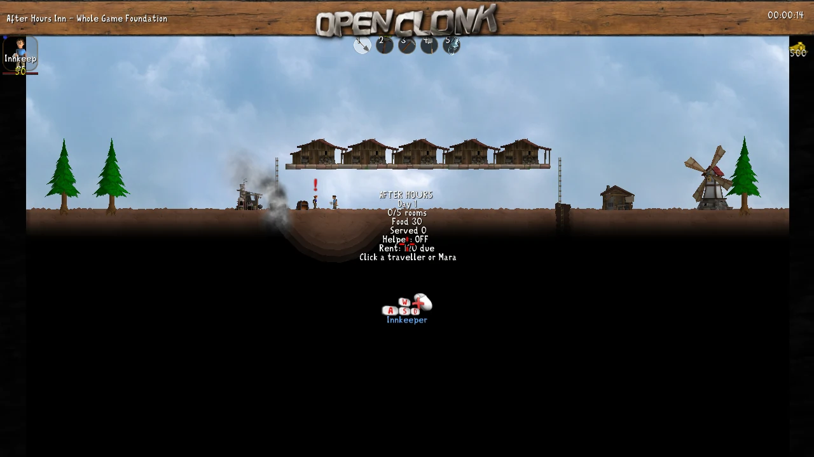
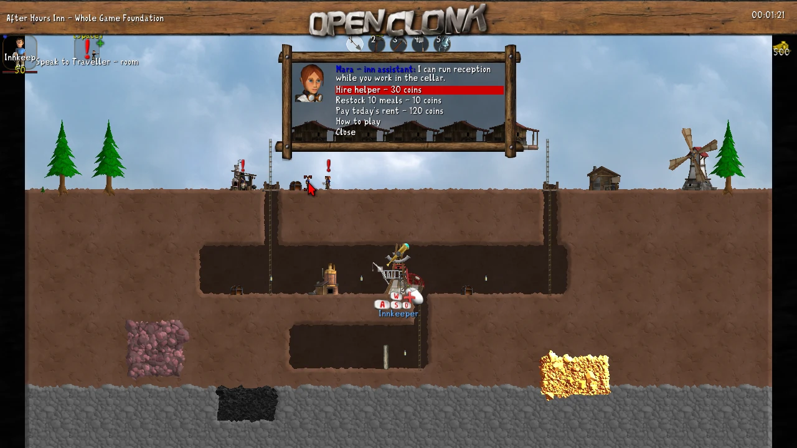
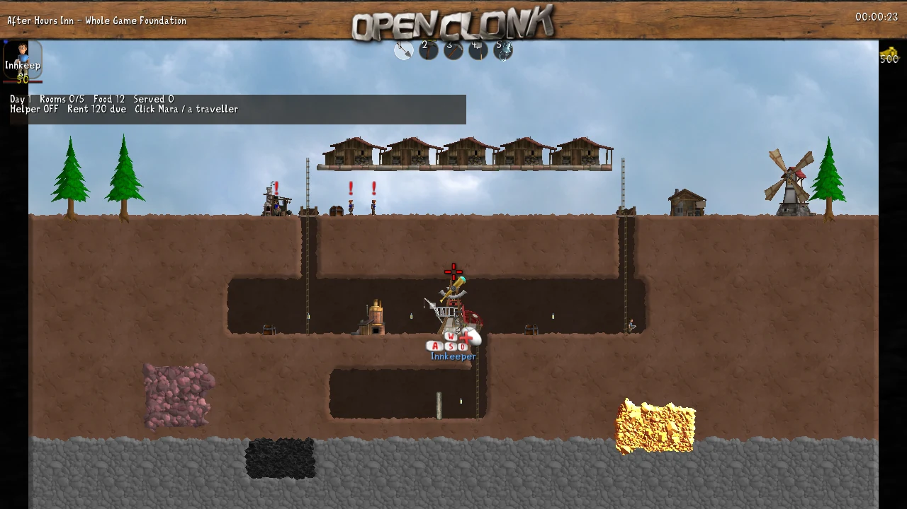
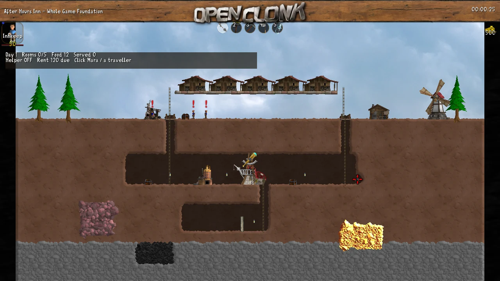
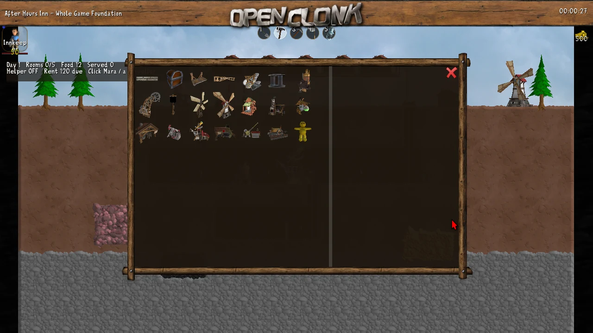

# OpenClonk 전체 원본 기반 여관 시나리오 0.1

## 이번 결과

기존 Godot 코드를 개조한 버전이 아니라 OpenClonk 8.1 전체 게임 위에 올린 별도 PC 시나리오다. 원본 엔진/게임/모델/인벤토리/도구/건설/대화 체계를 함께 사용한다. 기존 3D/2D 웹 주소는 이 시나리오의 실행 주소가 아니다.

전체 Windows 패키지는 GitHub Actions의 `OpenClonk inn Windows package` 실행에서 `AfterHours-OpenClonk-Windows` 아티팩트를 받는다. 압축을 풀고 START-INN.cmd 실행. 공식 원본 실행 파일과 게임 데이터·DLL을 포함하므로 별도 Godot 설치가 필요 없다. 시나리오 ZIP만 받으면 OpenClonk 8.1 설치가 필요하다.

## 원본 그대로 사용한 체계

| 영역 | 원본에서 가져온 것 | 이번에 추가한 것 |
| --- | --- | --- |
| 지형/굴착 | 연속 지형, 충돌, 삽/곡괭이, 파낸 지형 반영 | 고정 여관 맵, 연결된 지하와 광물 구역 |
| 이동 | Clonk의 걷기/점프/벽타기/사다리 동작과 MoveTo 명령 | 손님의 방문·퇴실 목적지, 사다리 끝의 NPC 방향/점프 정책 |
| 건설 | 망치 목록, 미리보기, 지형/접근/재료 조건 | 필요한 구조물을 시작 맵에 준비 |
| 보급 | 원본 Chest의 실제 내용물과 수량 | 식사 시 Bread 소비, 유료 Bread 보급 |
| 접객 | 원본 Dialogue와 인물 모델/상호작용 | 클릭 콜백, 요청→식사/방 배정/거절, 직원 고용/자동화 |
| 경제 | 원본 플레이어 Wealth | 식사12·객실35·고용30·보급10·월세120 |
| 시점/UI | 원본 카메라·GUI·대화·건설 UI | 지상/지하 전체 보기, 짧은 운영 현황, 대화 중 현황 숨김 |

새로운 물리 엔진이나 건설 미리보기를 작성하지 않았다. 원본 코드를 일부 뽑아 이전 Godot main.gd에 붙이는 어댑터도 없다. 소스 버전은 foundations/openclonk의 v8.1 커밋 5c6fadfb266d97b27904fd77f3f6e7f808bcb85e에 고정했다.

## 구현한 운영 흐름

- 처음 소지금 500. 지상 주방/보급함, 위층 객실 5개, 아래 창고/제련소/연구실/별도 방.
- 도로 왼편에서 손님이 약 14초 간격으로 걸어온다. 식사 손님과 숙박 손님이 구분된다.
- 손님을 클릭하면 먼저 요청을 듣고, 원본 대화 창에서 접객 또는 거절한다.
- 빈 객실을 배정하고 결제하며, 약 65초 후 점유를 해제한다. 만실이면 돌려보낸다.
- Mara를 클릭해 고용하면 접객을 자동화한다. 음식은 보급함의 실제 Bread를 소비한다.
- 하루 약 180초. 월세를 직접 낼 수 있고, 미납이면 하루 경과 시 차감된다.
- 지하 입구 두 곳에 원본 해치를 설치해 도로 통행 중 빠지는 것을 막는다. 플레이어는 원본 도구로 지하를 더 판다.

## 실제 확인과 범위

Linux OpenClonk 8.1 실제 렌더러에서 창을 열고 X11 마우스/키 입력을 보냈다. 원본 Gold Rush 실행을 먼저 캡처했다. 이후 여관 시나리오에서 인물 클릭→직원 메뉴→고용 비용 차감→자동 식사/객실 결제를 확인했다. 삽을 2초간 실제 누른 전후 지형 변화와 망치 건설 목록/미리보기도 캡처했다.

건설 클릭 한 지점은 원본의 접근 조건에 걸려 거절됐다. 따라서 '건설 설치/완공 전부 검증'으로 기록하지 않는다. 객실까지의 NPC 이동은 등반 끝에서 멈추는 문제가 드러나 원본 등반·점프 동작에 방향 지시를 추가했다. 최종 로그에서 객실 목적지 (469,198), (539,197), (619,197), (700,198), (780,198)에 실제 도착한 것을 확인했고, 이후 Room 1이 다시 배정되는 기록도 확인했다. 상용 수준 안정성 또는 모바일 조작감 검증으로 해석하지 않는다.

Linux 촬영 환경에서는 Xvfb/Mesa와 로컬 EGL 호환 보조를 사용했다. Windows 배포에는 이 보조를 넣지 않고 공식 Windows 바이너리를 사용한다. Windows 기기에서 직접 플레이한 것은 아니다.

## 전후 화면

비교 화면은 모두 1280×720 실제 캡처다. before는 이 여관 시나리오의 초기 시야/가운데 현황 상태(게임 약 14초), overview는 같은 시작 배치의 전체 시야/상단 현황 상태다. 정확한 같은 프레임의 픽셀 회귀 비교는 아니며 캡처 시각 차이가 있다. 생성 이미지나 목업이 아니다.

## 장점과 현재 한계

장점은 채굴/충돌/아이템/원본 건설/대화에 필요한 구현 범위를 줄였다는 것이다. NPC의 이동 명령과 사다리 동작도 기존 코드 위에서 고칠 수 있다. 지하 확장은 블록 객체를 새로 붙이는 방식이 아니라 원본 지형을 실제로 깎는다.

이 결과는 아직 우리가 원하는 완성된 여관 타이쿤이 아니다. 방은 점유/결제/이동 단계이며 침대·숙면·청소 연출이 없다. 식당 테이블/서빙 연출, 가족 단위 예약, 감옥 운영/수감자 AI, 암살/운반, 세력/의심/조사는 없다. 연구실과 문이 있는 지하 방을 기능이 완성된 감옥이라고 부르지 않는다.

현재 영어 PC 조작이며 터치 전용 이동/세로 모바일/웹 빌드는 아니다. 기존 원본의 건설 재료·접근 조건도 남아 있다. 따라서 전체 원본 기반으로 구현 범위를 줄인 것은 확인했지만, 모바일 최종 엔진으로 채택했다고 선언하지 않는다. 다음 판단은 PC 원본 체계의 장점과 모바일 전환 비용을 함께 보고 해야 한다.

## 소스·권리

experiments/openclonk/UPSTREAM.md 및 licenses/를 따른다. 공식 Windows 원본의 COPYING/AUTHORS/Credits.txt/LGPL.txt도 보존한다. 공식 추가 사운드트랙은 넣지 않았다. 전체 원본 소스와 시나리오 수정 파일은 GitHub에서 확인할 수 있다.
