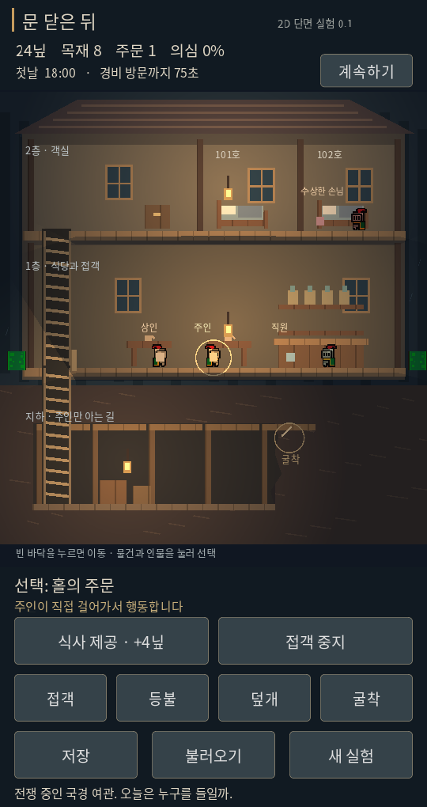
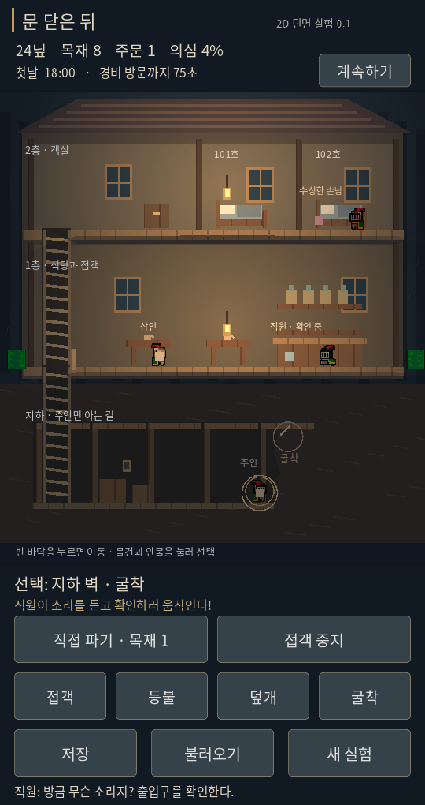

# 2D 세로 단면 비교 시제품 0.1

2026-10-17. 기존 3D 0.9는 유지하고 별도 Godot 프로젝트로 제작했다.

- [2D 실행](https://kkhkkh20-bit.github.io/after-hours-inn/sideview/)
- [기존 3D 실행](https://kkhkkh20-bit.github.io/after-hours-inn/)
- 로컬: `prototypes/sideview/project.godot`를 Godot 4.7.2로 Import.
- Windows 자동 빌드: 기존 Actions 아티팩트의 `sideview/AfterHours2D.exe`와 PCK를 함께 실행.

## 실제 렌더 화면

Godot를 실행해 캡처한 화면이다. AI 콘셉트 이미지가 아니다.
화면 비교를 위해 직원 고용·지하 3구간 확장 상태를 설정하고 일시정지한 캡처다.
일반 시작은 지하 미확장·직원 미고용·24닢이며 직접 조작해야 한다.

## 3분 테스트 순서

1. 빈 바닥을 클릭하면 주인이 이동한다. 층을 누르면 왼쪽 계단을 거쳐 이동한다.
2. `직원 고용 · 8닢`을 누른다. 주인이 카운터까지 걸어가 고용하고 직원이 주기적으로 주문을 처리한다.
3. `덮개`를 누르면 주인이 출입구로 가서 연다. 지하 바닥을 눌러 내려간다.
4. 지하에 도착한 뒤 다시 `덮개`로 닫고, `굴착`을 누른다. 주인이 벽으로 가서 4초 동안 작업하고 목재 1개로 통로를 확장한다.
5. 덮개를 열어 같은 작업을 반복한다. 소음이 더 전달되어 직원이 출입구 또는 지하의 소리 위치를 확인하러 움직인다. 의심도 올라간다.
6. 현재 층에서 `등불`을 누르면 주인이 광원으로 가서 켜고 끈다. 원거리 식별이 줄지만 바로 앞에서는 발견된다.
7. 손님을 누르면 선택된다. `기절 · 틈 노리기`를 누르면 주인이 뒤쪽 접근을 시도한다. 상대가 돌아보거나 이동해 조건이 바뀌면 실패할 수 있다.
8. 기절한 손님을 선택해 `끌고 가기` 후 바닥을 누르면 느리게 운반한다. `내려놓기`로 놓는다. 목격되면 의심이 오른다.
9. 객실 변경은 다음 귀실 목적지를 바꾼다. 두 손님은 식당과 자신의 객실 사이를 이동한다.
10. 이동·작업·운반을 멈춘 뒤 저장한다. 2D 전용 저장을 사용하며 기존 3D 저장과 섞이지 않는다.

## 연결된 규칙

- 720×1360 세로 화면, 클릭·터치의 마우스 에뮬레이션, 큰 주요 행동 버튼.
- 2층 객실 2개·1층 식당·확장 가능한 지하 통로. 계단은 실제 연속 이동이다.
- 수동 접객 +4닢, 직원 고용 8닢, 직원 자동 접객과 90초마다 급여 6닢.
- 통로 최대 6구간, 구간당 4초·목재 1개. 화면에는 이어진 지하로 표시한다.
- Godot 2D 광원과 층 경계 그림자. 감지 판정은 같은 광원 위치·켜짐 상태를 이용하는 간단한 거리 모델이다.
- 층간 소리 감쇠와 덮개에 의한 추가 감쇠. 직원의 실제 확인 이동, 의심 상승.
- 기절·운반·목격 상태. 75초마다 경비 조사 이벤트와 정황에 따른 벌금.
- 핵심 진행 상태 저장/불러오기. 불러오면 NPC의 진행 중 이동 계획은 초기화한다.

## 검증

- 2D 규칙 검사 31개 통과: 출입 차단, 실제 이동 후 고용, 직원 접객, 덮개별 청취 차이, 굴착 비용과 확장, 조명·방향·거리·층별 시야, 기절/운반, 일시정지, 경비 결과, 자금/확장 한계.
- 실제 Godot 뷰포트 입력으로 일시정지·직원 고용·덮개 선택/행동·굴착 선택/행동, 저장/불러오기 시나리오 통과.
- 기존 3D 검증 146개 + 포인터 검증 45개도 통과.
- Web·Windows의 3D와 별도 2D 내보내기를 로컬에서 완료. GitHub Actions에서도 같은 빌드 절차를 실행한다.
- Linux 실제 렌더를 확인. 실제 Android/iPhone/Windows 기기에서의 조작·성능 검증은 아직 하지 않았다.

## 아직 없는 것

이 시제품은 완성된 여관 게임이 아니다. 두 손님과 반복 주문으로 구조를 시험한다.
실제 암살/사망/시신 처리, 독, 손님 간 싸움과 음모, 세력, 세금·월세, 심문, 여러 깊이의 지하층, 마당 확장은 아직 없다.
경비는 타이머 기반 결과 이벤트이며 화면에 들어오는 경비 NPC나 현장 탐색 AI는 없다.
방 배치는 귀실 위치만 바꾸며 아직 손님 관계 사건을 만들지는 않는다.
화면의 불빛과 감지 판정이 픽셀 단위로 일치하는 물리 조명 시뮬레이션은 아니다.
기본 타격/이동/굴착에는 임시 탭 소리를 쓴다. 최종 중세 의상·전용 작업 애니메이션·미술·사운드는 후속이다.

## 공개 리소스와 제작 방식

Brackeys Platformer Bundle의 CC0 캐릭터·지형·탭 소리를 실제 반입했다.
출처·조건과 원작자 표기는 `prototypes/sideview/assets/THIRD_PARTY.md`에 보관했다.
WAV는 원본 PCM 샘플을 유지하면서 파일 컨테이너를 다시 저장했다.
폰트는 기존 OFL 한국어 폰트를 필요한 글자로 서브셋했다.
건물·가구·땅 경계는 코드로 직접 그렸다. 다른 게임의 스크린샷이나 유료 에셋은 사용하지 않았다.
이번 추가 현금 지출과 회원가입은 없다.

다음 판단은 실제 조작 후 한다: 세로 단면에서 손님과 직원의 행동이 잘 읽히는지, 지하 작업과 영업을 오가는 것이 재미있는지. 이 결과 전까지 기존 3D를 폐기하거나 최종 미술 방향을 확정하지 않는다.
