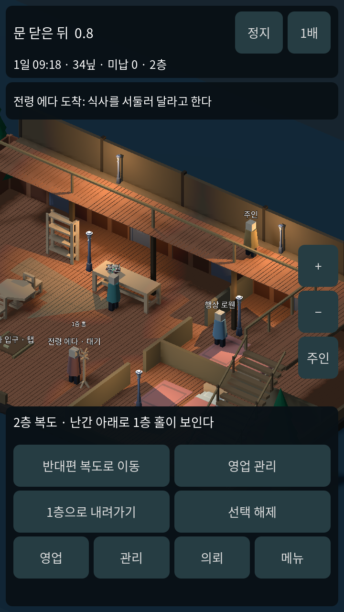
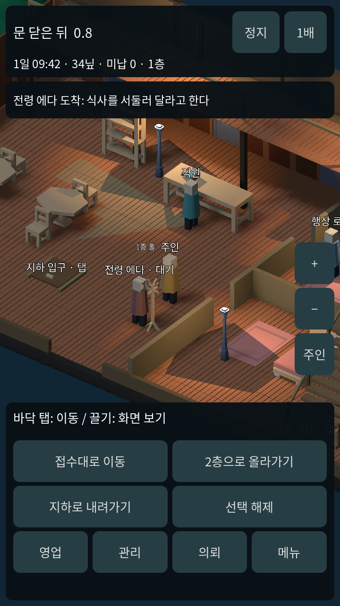
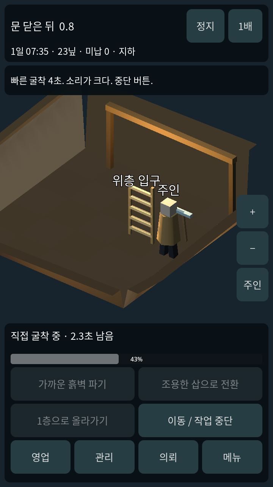

# 0.8 공간감 시제품

문제: 층 전환 시 지상 전체가 사라지고, 지하 흙이 큰 정육면체로 보였다. 기능 검증만으로 여관 공간이 설득력 있는지는 판단할 수 없었다.

## 변경

- 실제 높이 3.2의 L자 목재 복도와 난간, 기둥, 조명을 추가했다. 중앙은 1층 홀이 보이는 빈 공간이다.
- 오른쪽 계단은 1층 (8,5)에서 2층 (8,1)까지 연결한다. 주인의 높이가 경사에 맞게 바뀌며, 카메라는 높이를 따라 이동한다.
- 2층에서도 1층 모델과 손님·직원을 그린다. 직원 영업과 손님 시간은 계속 흐른다. 아래층 인물의 원격 제압·배달은 허용하지 않는다.
- 모바일 하단 2층으로 올라가기, 1층으로 내려가기, 반대편 복도 이동과 복도 바닥 탭을 지원한다. 기존 지하 진입 버튼도 유지했다.
- 굴착 데이터는 그대로 두고 지하 바닥을 하나의 연결된 삼각형 메시로, 외곽을 흙벽으로 그린다. 정육면체는 제거했다. 카메라 쪽 벽은 낮게 잘라 내부를 볼 수 있게 했다.
- 벽 클릭은 실제 흙벽의 얇은 면 범위를 검사한다. 목재 지지대와 입구 사다리로 지하실의 구조를 보여준다.
- 2층 저장과 불러오기, 운반 높이, 2층에서 회복한 인물이 계단으로 내려와 출구로 달아나는 처리를 연결했다.

## 실제 렌더링

모두 720×1280 Godot 실행 캡처다. 콘셉트 이미지가 아니다.

## 검증과 범위

시뮬레이션 133개와 실제 포인터/터치 37개, 합계 170개. 기존 영업·의뢰·굴착·구금·조사 회귀를 포함한다. 실제 휴대폰 성능·안전 영역은 미검증이다.

현재 객실과 직원 영업은 1층에 남아 있다. 2층은 걸을 수 있는 공간감 시제품이며 객실 확장이나 NPC의 일상 계단 이동이 완성된 것은 아니다. 난간 너머를 내려다보는 것은 플레이어 화면 표현이며 층간 AI 시야·도청·발각은 별도 구현이 필요하다. 지상↔지하는 여전히 별도 화면이다. 기존 모델 재사용, 추가 구매 없음.
