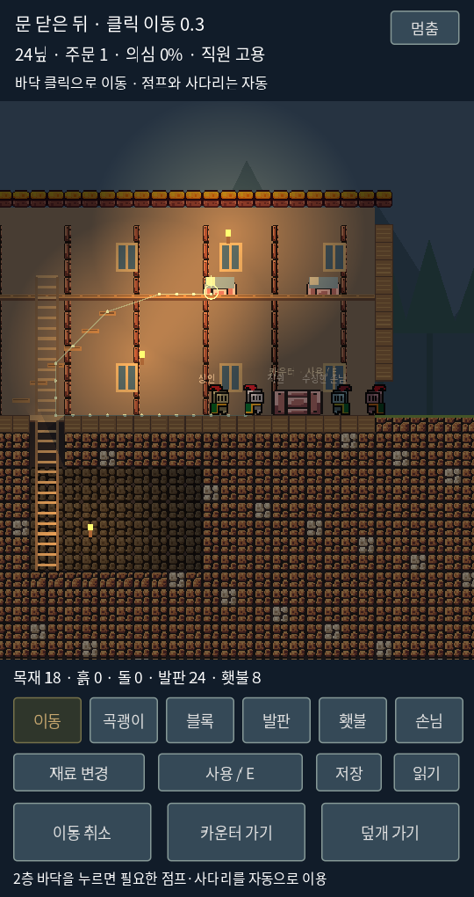
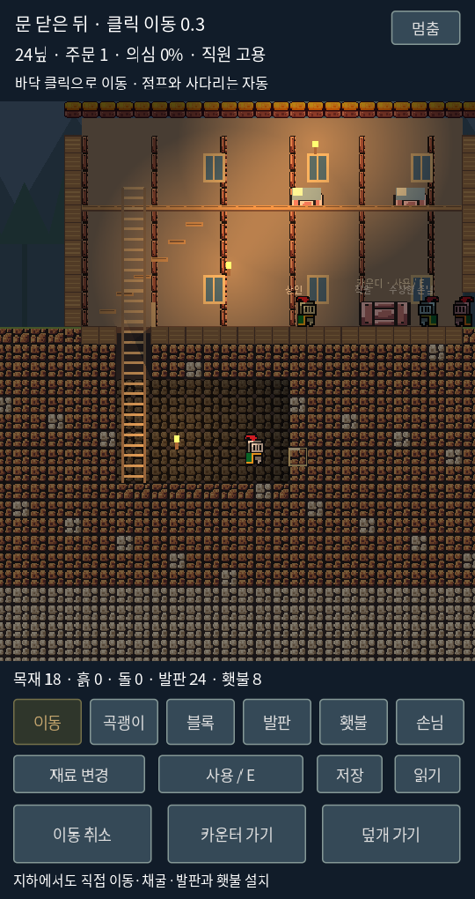

# 모바일 클릭 이동 0.3 — 스타듀밸리 조작 조사와 적용

2026-10-17. 사용자가 모바일 직접 조작이 애매하다고 평가하고 스타듀밸리 조작 조사를 요청해 기본 조작을 바꿨다.

[현재 실행](https://kkhkkh20-bit.github.io/after-hours-inn/sideview/?v=tap03) · [이전 직접 조작 0.2](direct-control-poc.md)

## 확인한 원작의 조작

출처: [Stardew Valley Wiki — Mobile Controls](https://stardewvalleywiki.com/Mobile_Controls), [ConcernedApe의 한국 App Store 소개](https://apps.apple.com/kr/app/stardew-valley/id1406710800), [개발사 모바일 발표](https://www.stardewvalley.net/stardew-valley-coming-to-mobile/).

위키는 기본 모바일 조작을 화면 탭 이동과 자동 공격으로 설명한다. 물건을 누르면 사용하고 대상에 맞는 도구를 자동 선택하며, NPC를 누르면 접근해 상호작용한다. 막힌 목적지는 빨간 표시로 알린다. 개발사의 앱 소개도 자동 도구 선택과 여러 조작 방식, 두 손가락 확대를 안내한다.

이 조사는 공식 소개와 위키 문서 기반이다. 실제 스타듀밸리 앱을 실행해 손맛을 비교한 리뷰가 아니다. 아래는 우리 단면 게임에 맞게 새로 구현한 규칙이다.

## 적용한 방식

| 입력 | 우리 게임의 결과 |
|---|---|
| 이동 모드에서 바닥 한 번 누르기 | 실제 충돌 지형을 바탕으로 경로를 만들고 주인이 이동 |
| 2층이나 지하의 바닥 누르기 | 경로에 필요한 점프·발판·사다리를 자동 이용 |
| 카운터 누르기 | 가까이 이동한 뒤 고용 또는 접객 |
| 덮개 누르기 | 접근해 열고 닫기. 닫힌 덮개를 통과하는 경로는 차단 |
| 횃불 누르기 | 접근한 뒤 회수 |
| 묻힌 흙·돌 누르기 | 곡괭이 자동 선택. 필요하면 작업 가능한 자리로 이동해 한 칸 채굴 |
| 손님 누르기 | 선택하고 가까이 접근. 이것만으로 공격하지 않음 |
| 손님 선택 후 기절 시도 누르기 | 접근 후 거리·시선·빛·목격 조건을 확인하고 기절 시도 |
| 블록/발판/횃불 모드에서 빈칸 누르기 | 기존 설치 규칙 적용 |
| 새 바닥 누르기 또는 이동 취소 | 이전 이동/자동 작업 취소 |

여관 바닥을 실수로 파지 않도록 걸을 수 있는 흙·돌의 윗면은 이동 대상으로 해석한다. 묻힌 벽면이 자동 채굴 대상이다. 바닥 자체를 파거나 목재를 해체하려면 명시적으로 곡괭이 모드를 선택한다.

원작의 자동 공격은 이 여관에 그대로 적용하지 않았다. 손님은 적대 여부를 관찰해야 하는 인물이므로 선택/접근과 기절을 분리했다. 이는 우리 게임의 설계 판단이다.

## 이동과 UI

모바일의 왼쪽/오른쪽·점프 버튼을 제거하고 이동을 기본 모드로 설정했다. 경로와 도착 지점을 표시하고 갈 수 없는 목적지는 빨간색으로 표시한다. 이동 취소, 카운터 가기, 덮개 가기 버튼을 제공한다. PC의 A/D·Space·W/S 직접 조작은 보조로 남겼으며 키 입력 시 자동 이동을 취소한다. 1~6은 이동/곡괭이/블록/발판/횃불/손님 모드다.

캐릭터를 순간 이동시키지 않는다. 표면과 사다리의 연결로 경로를 계산하고 기존 CharacterBody2D의 중력·충돌·점프를 구동한다. 예상보다 높은 발판에 착지하면 실제 위치에서 목적지까지 다시 계획한다. 사다리 끝에서는 바닥 모서리에 걸리지 않게 발 높이를 맞춘다. 지형이 변경되면 진행 중 경로를 취소한다.

## 실제 화면

Godot 실행 캡처다. 직원 고용 상태로 정지한 화면이며 지상 화면에는 2층 목적지까지의 계획 경로를 표시했다. 일반 시작은 직원 미고용이다.

## 검증과 한계

기존 2D 규칙 48개와 3D 검증 191개를 유지한다. 실제 물리 프레임에서 클릭 목적지 도착·2층 자동 이동·닫힌 덮개 차단·열린 덮개를 통한 지하 이동·지상 복귀·작업 위치 접근과 자동 채굴·카운터 접근 후 고용·네이티브 터치 목적지·취소 버튼을 검증한다. Web/Windows 빌드 절차에 포함한다.

단면 게임이므로 스타듀밸리의 위에서 보는 이동을 그대로 재현한 것은 아니다. 같은 손맛이라고 단정할 수도 없다. 실제 iPhone/Android 하드웨어 검증은 아직 필요하다. 핀치 확대·손가락을 따라 계속 이동하기·터치 조작 방식 선택 메뉴·인벤토리 드래그는 이번에 구현하지 않았다. 설치는 여전히 가까운 빈칸을 직접 지정하는 방식이다.

움직이는 NPC가 선택 후 자리를 옮길 수 있다. 현재 접근은 선택 시점의 위치를 기준으로 하며 행동 직전에 다시 거리를 확인한다. NPC가 지형을 바꾸거나 목적지를 완전히 막는 상황의 고급 동적 회피는 미완성이다. 경로가 일정 시간 진행되지 않으면 멈추고 재지정을 안내한다. 자동 채굴·접객 도중에도 게임 시간과 소리/의심 규칙은 계속 흐른다.

스타듀밸리의 원본 에셋이나 코드는 반입하지 않았다. 현재 공개 에셋은 기존 Brackeys CC0 팩이고, 인물·가구·여관 미술은 여전히 시제품 수준이다.
