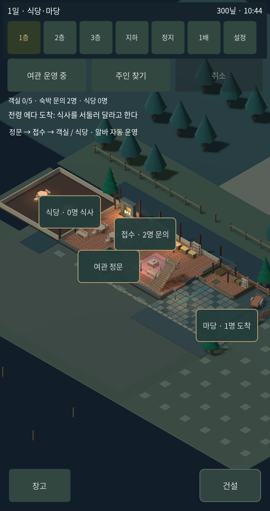
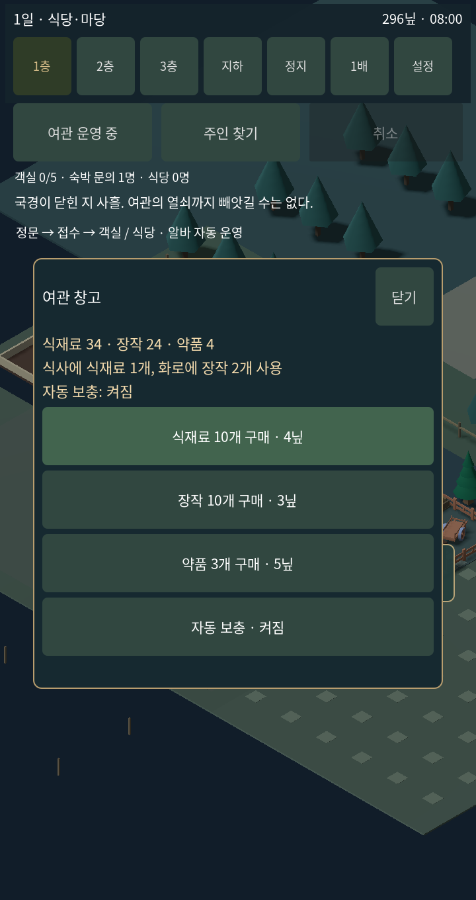
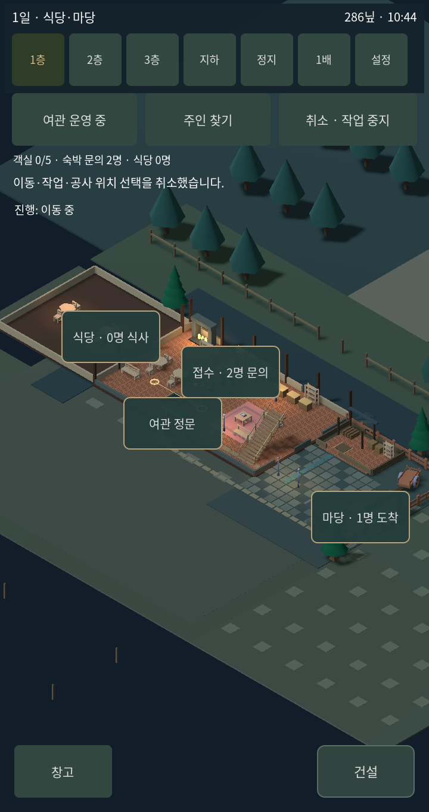
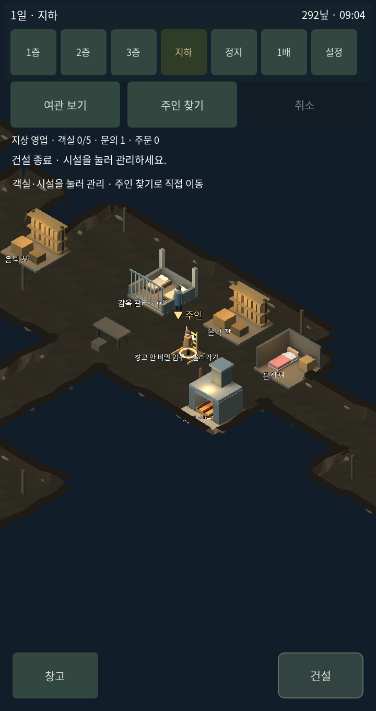

# v1.8.4 공개 시스템 네 가지를 실제 여관 플레이에 연결

## 실제 사용한 소스

| 출처 | 고정 커밋 | 이번 게임에서의 역할 |
|---|---|---|
| [Kenney City Builder](https://github.com/KenneyNL/Starter-Kit-City-Builder) | 4535092b740b378b700efd9df9e27a631815b84a | 건설·회전·철거·카메라. v1.8.3에서 도입한 기반 유지 |
| [Iso & Orbit](https://github.com/Maxwell-M1/iso_and_orbit_godot) | 32d54ce71dff54bae7ae6a35bb2634c382869df0 | GroundMotion 가감속과 ClickMarker 목적지 표시. LocomotionSettings도 원본 사용 |
| [GLoot](https://github.com/peter-kish/gloot) | 6b09b87ac07a8536779ef1ab0fafc7e99830f948 | 실제 Inventory·InventoryItem 스택 추가·제거·수량 변경 |
| [Interaction System](https://github.com/snddude/godot-interaction_system) | 2d95e6ab7496c470309783b8413cf91c574c7557 | Interactable 신호를 통해 클릭 대상을 한 번 활성화. 떠난 손님은 비활성화 |

원본 모듈·MIT 라이선스·출처는 addons와 third_party에 보존했다. 기능이 겹치는 카메라나 또 다른 입력기는 동시에 켜지 않았다. 각 라이브러리의 에디터 플러그인은 활성화하지 않고 런타임 코드를 사용한다.

## 바뀐 플레이

- 창고 버튼: 식재료·장작·약품 구매, 자동 보충 설정. 큰 관리창에서 수량과 가격을 확인한다.
- 식사 한 번에 식재료 1개. 화로 작업 시작에 장작 2개. 수감자 회복약에 약품 1개와 기력 회복 30.
- 초기 식재료 24·장작 24·약품 4. 자동 보충은 기본 켜짐이며 보충 비용은 실제 돈에서 빠진다. 돈이 부족하면 사용을 거부한다.
- 저장은 아이템 수량을 기존 여관 저장 안에 기록한다. 로드 시 GLoot 스택을 복구한다.
- 클릭 이동의 기본 최고 속도를 4.93→6.8로 올렸다. 가감속은 가져온 GroundMotion이 계산하고, 실제 경로는 기존 여관 경로를 따라가므로 벽을 가로지르는 곡선 이동을 넣지 않았다.
- 클릭 목적지에는 가져온 ClickMarker가 나타났다가 도착·취소 시 사라진다.
- 추가한 라이브러리를 단순 파일 수집으로 끝내지 않고 식사·재고·이동·선택 흐름에 연결했다.

이번에 전체 RPG 캐릭터·물리 엔진이나 원본 게임 전체를 교체한 것은 아니다. 점프·전투·별도의 탐색 카메라·GLoot 에디터 UI·1인칭 레이캐스트 입력은 활성화하지 않았다.

## 직접 실행해 확인한 내용

1. [통합 18항목](template-mix-v184-checks.txt): 실제 GLoot 재고 구매·자동 보충·부족 시 거부·저장 복구·식사 소비·약품 사용·화로 연료·신호 선택·이동 가속·3층/지하 왕복·3일 분량 시뮬레이션.
2. [건설 22항목](template-mix-v184-building.txt): 설치·비용·회전·철거·중복 거부·감옥 점유 보호·카메라 드래그.
3. [실제 렌더러 터치 9항목](template-mix-v184-touch.txt): 코드에서 화면 좌표에 터치 입력을 보내 창고 구매 → 바닥 이동 → 3층 → 지하 → 건설 → 중복 배치 거부를 연속 실행. main._physics_process를 0.05초 간격으로 진행했다.

통합 중에는 경로 첫 지점이 현재 위치일 때 이동이 멈추는 문제가 발견되어 수정했다. GLoot 원형 참조 캐시는 종료 때 정리해 테스트 종료 자원 경고도 해소했다. 실제 휴대폰 하드웨어에서 시험한 결과는 아니다.

빌드 파이프라인은 이제 배포 전에 통합·건설 테스트를 실행한다. 렌더러 터치 테스트는 tools/play_template_mix.gd와 tools/run_mobile_capture.py로 별도 실행한다.

## 실제 화면

아래 일반 화면은 동일한 720×1360, 동일 게임 시각의 수정 전후다. 창고·이동·건설 작업 화면은 별도의 터치 플레이에서 촬영했다.

| 변경 전 | 변경 후 |
|---|---|
|  |  |

