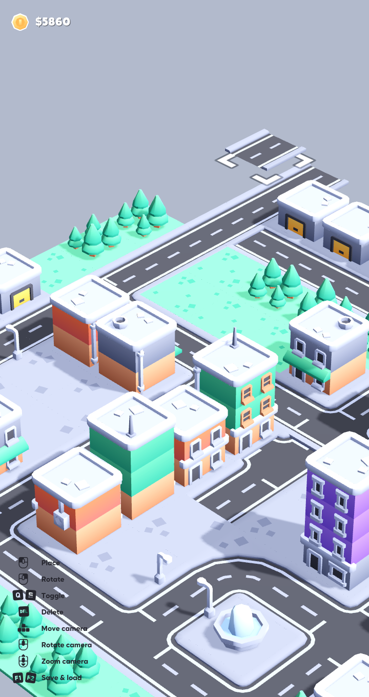
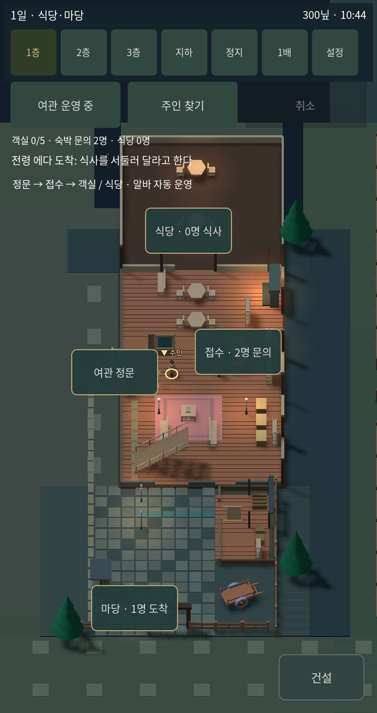
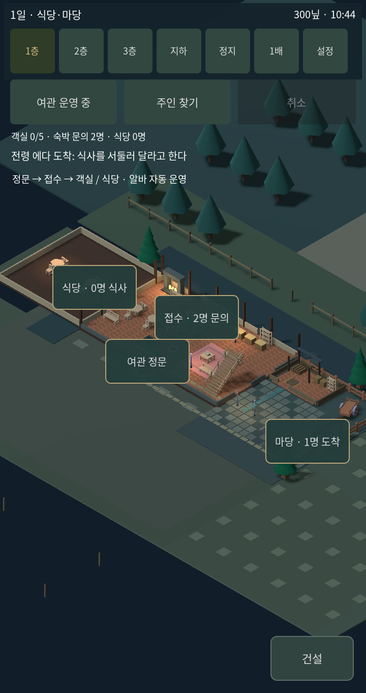
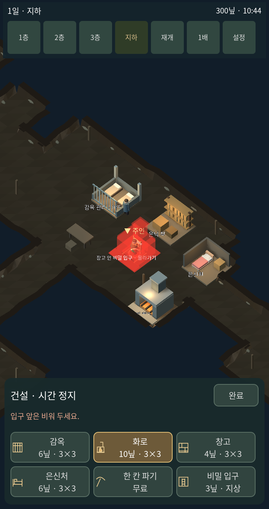
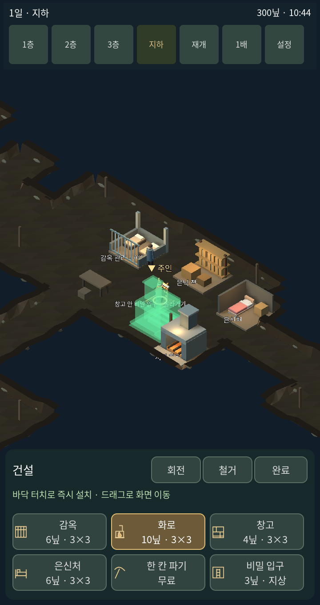
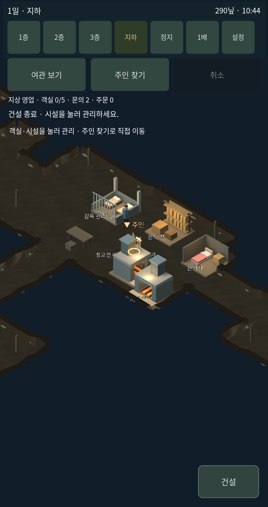

# v1.8.3 Kenney City Builder 시스템 도입

## 가져온 코드

원본: https://github.com/KenneyNL/Starter-Kit-City-Builder
고정 커밋: `4535092b740b378b700efd9df9e27a631815b84a`
라이선스: MIT. 원본 저작권 및 전문은 `third_party/kenney_city_builder/LICENSE.md`에 보존하고 웹·윈도우 배포에도 동봉한다.

원본 프로젝트를 별도 폴더에서 실행해 샘플 지도를 불러온 뒤 아래 화면을 촬영했다. 이번 게임 전체가 원본 도시 건설 게임으로 교체된 것은 아니다.

| 원본 코드 | 게임에 연결한 경로 |
|---|---|
| builder.gd — MeshLibrary 생성, 모델 미리보기, GridMap 배치, 회전 저장, 철거 | inn_kenney_backend.gd가 상속하고 원본 메서드를 호출 |
| structure.gd — 모델·가격 Resource | 여관 감옥·화로·창고·은신처 모델을 Resource로 등록 |
| data_map.gd, data_structure.gd | 원본 건설 상태와 가격 처리에 사용 |
| view.gd — 위치·회전·카메라 거리 보간 | inn_kenney_camera.gd가 상속, 실제 게임 Camera3D의 변환을 갱신 |

view.gd와 Resource 클래스는 그대로 복사했다. builder.gd는 원본 Audio 자동 로드 대신 게임 효과음을 주입하는 멤버 한 줄과 출처 주석을 추가했다. 모델 프리뷰와 배치·철거 메서드는 원본이다. 기존 여관 경제와 중복 결제를 막기 위해 원본 건설 처리가 끝난 금액을 여관 상태에 한 번 반영한다.

## 터치 연결과 범위

- 건설 → 시설 선택 → 바닥 터치. 같은 시설을 연속 배치할 수 있다.
- 회전 버튼으로 90도씩 회전. 설치 방향은 여관 저장 데이터에 남는다.
- 철거 선택 → 시설 터치. 비용 절반 환급. 사용 중인 시설·수감자가 있는 감옥은 철거를 거부한다.
- 겹침·입구·3×3 바닥·비용 판정은 여관 규칙이 담당한다. 원본의 무제한 덮어쓰기 대신 배치 전 판정한다.
- 원본 PC 입력은 기존 터치 라우터에 연결했다. 손가락을 떼기 전에도 드래그 카메라가 움직이도록 수정했다.
- 원본 모델을 그대로 도시로 덮지 않고, 여관 시설 모델을 원본 미리보기 컨테이너에 넣었다.
- 일반 영업·객실·고용·손님·지하 기능과 기존 저장은 유지한다. 저장 형식은 원본 map.res로 교체하지 않는다.
- 클릭 이동/계단은 기존 코드이며 Iso & Orbit은 이번 도입 범위에 포함하지 않는다. 가구별 물리 충돌과 NPC 동선을 완성한 패키지라는 뜻도 아니다.

기존 v1.8.2는 Git 커밋 `61c8a8285ed28d5d05bb23f37e3e00204b336ad3`에 남아 있다.

## 관리 카메라

Kenney 기본 장면의 대각선·약 35도 내려다보는 방향을 1층과 지하 건설 시점에 사용한다. 1층은 식당과 마당이 함께 들어오도록 배율을 38로 조정했다. 손가락 드래그와 두 손가락 확대·축소가 가능하다.

| 이전 1층 | 템플릿 방향을 적용한 1층 |
|---|---|
|  |  |

## 적용 전후 — 실제 게임

720×1360, 같은 게임 시각·주인 위치·초기 시설로 촬영했다. 적용 전은 수정 전에 보존했다. 적용 후 미리보기는 화로를 회전해 설치 가능한 위치에 표시한 상태다.

| 도입 전 | 도입 후 |
|---|---|
|  |  |

## 확인한 동작

[22개 항목 기록](template-v183-checks.txt): 실제 원본 스크립트 상속, 원본 GridMap 배치, 터치 설치, 단일 결제, 회전 저장 데이터, 철거·재환급 차단, 점유 감옥 보호, 시간 정지/복귀, 드래그 중 카메라 갱신. 실제 휴대폰 성능 확인은 포함하지 않는다.
