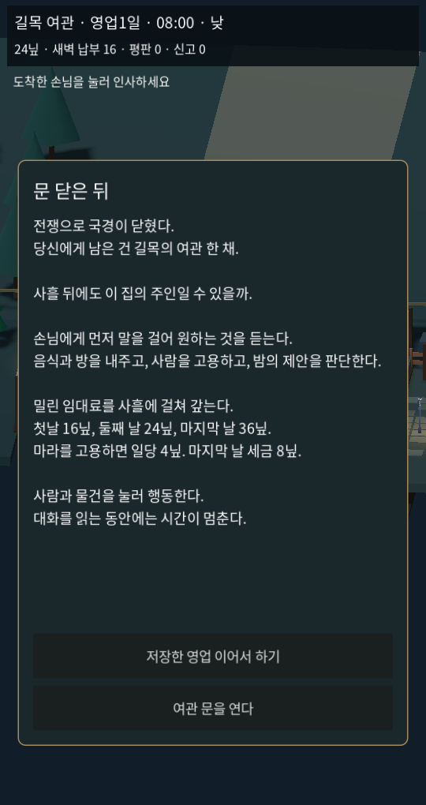
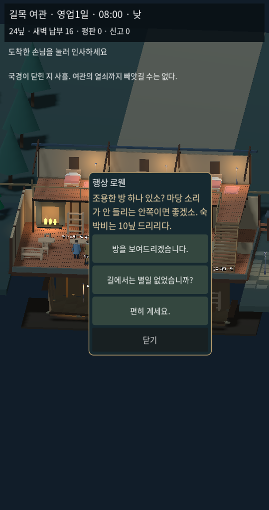
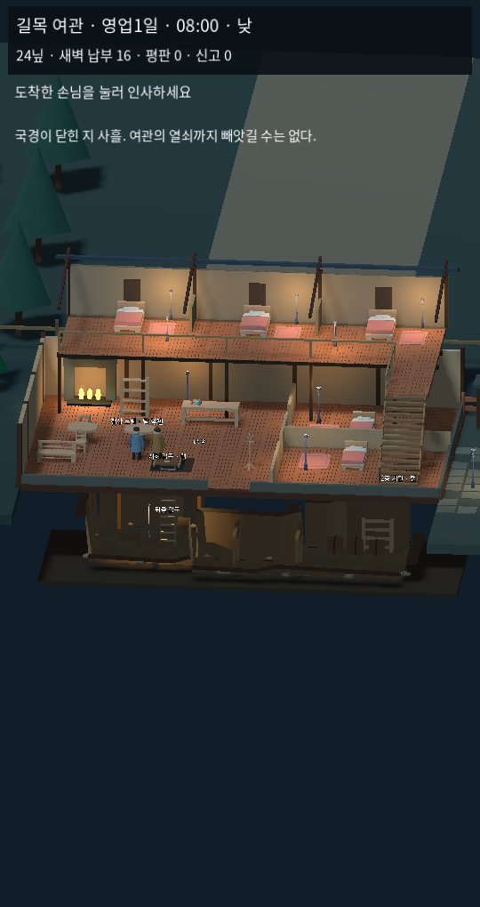
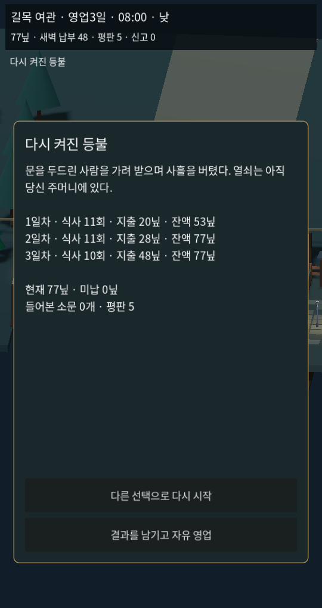

# 1.3 — 문 닫은 뒤: 사흘의 영업

현재 3D 실행의 기준이다. 이전 1.2의 즉시 방 번호 메뉴와 별도 4분 사건 모드는 이번 기본 시작에 사용하지 않는다. 2D는 비교판을 유지한다.

## 핵심 플레이

사람 클릭 → 주인이 실제로 접근 → 대화 → 요구 확인 → 제안 → 방 선택/식사 제공이다. 처음 보는 손님에게 바로 1호·2호 배정 버튼을 띄우지 않는다. 알려지지 않은 손님은 접수 요청 자체도 대화를 건너뛸 수 없다. 대화를 읽는 동안 시계를 멈추고, 버튼은 움직이지 않게 고정한다. 긴 답변은 줄바꿈한다.

조용한 안쪽 방을 원하는 사람, 출입이 편한 방을 원하는 사람, 숙박 없이 식사만 하는 사람의 응답이 다르다. 요구에 맞는 방은 팁과 평판으로 이어진다. 빈방이 더러우면 정리 후 안내를 한 번 선택해 이어서 처리한다. 식사는 준비·운반·전달·결제로 연결한다.

운영은 08시부터 다음 날 08시까지 한 영업일이다. 게임 24시간은 현실 8분이며 대화 일시정지와 야간 휴식에 따라 실제 플레이 시간은 달라진다. UI는 자정의 날짜와 혼동하지 않도록 영업일을 표시한다.

## 사흘의 사건과 비용

| 구간 | 실제 등장·선택 | 결과 |
| --- | --- | --- |
| 첫 접객 | 일반 손님에게 요구를 듣고 방·식사 제안 | 숙박료·식사료·팁·평판 |
| 식사 제공 이후 | 마라가 일자리를 찾아 들어옴 | 직접 대화 후 8닢 고용, 서빙 위임, 매 영업일 일당 4닢 |
| 첫날 저녁 | 회색 망토가 상자 보관을 제안 | 수락 +12닢·지하 상자 / 거절 / 상자 내용 질문 |
| 매일 밤 | 순찰대가 마당에서 걸어와 설명을 요구 | 장부 공개·거짓 설명·8닢 뇌물·발견한 반입 허가 제시 |
| 둘째 날 | 돈 없는 부상 전령이 도움을 요청 | 무료 객실·식사 지원·거절; 이후 기록과 결말에 반영 |
| 셋째 날 | 징수원이 직접 방문 | 8닢 세금 납부; 미납 시 새벽 정산, 중복 청구 방지 |
| 매일 08시 | 영업 요약과 임대료·일당 정산 | 다음 날 진행·자동 저장·미납·결말 |

밀린 임대료는 16 → 24 → 36닢으로 분납한다. 고용하면 일당 4닢이 추가되고, 셋째 날 세금은 총 8닢이다. 현재 경제 수치는 플레이 검증용이며 유저 난도 검증이 끝난 최종 밸런스가 아니다.

마라를 고용하고 그날 조사를 마친 밤에는 장부에서 영업을 맡기고 새벽까지 쉴 수 있다. 남은 시간의 손님·직원·수입은 실제 시뮬레이션으로 처리하며 돈이나 시간을 임의로 채워 넣지 않는다.

## 지하를 팔 이유

소문을 들으면 지하 동쪽의 낡은 자국을 찾을 수 있다. 실제로 흙벽을 확장해 묻힌 장부와 6닢을 발견한다. 장부의 반입 허가는 조사 대화에 새로운 답을 열고, 경비의 처분과 마지막 결말을 바꾼다. 굴착·소음·직원의 확인·입구 덮개·조명을 기존 규칙과 함께 사용한다. 상자는 수락 시 보관 상태와 지하 외형으로 표시하며 수동 화물 운반 시스템은 아니다.

기존 붙잡기·기절·살해·운반·구금·목격·신고도 유지한다. 신고가 세 번 쌓이면 여관이 봉인된다. 임대료를 갚지 못한 빚도 사흘 진행의 실패로 이어진다.

## 끝까지 이어지는 여섯 결과

| 결과 | 주요 조건 |
| --- | --- |
| 다시 켜진 등불 | 밀수 거래 없이 영업을 유지하고 사흘 정산 |
| 값비싼 침묵 | 수상한 돈·신고 기록을 남긴 채 사흘 정산 |
| 국경의 은신처 | 거래를 받아들이고 전령도 도운 기록 |
| 여관의 진짜 주인 | 지하 장부의 증거를 조사에서 사용 |
| 빚으로 넘어간 열쇠 | 결산 미납이 20닢 초과 |
| 봉인된 여관 | 목격자의 신고가 세 번 누적 |

결말 뒤 다른 선택으로 재시작하거나 결과를 남기고 자유 영업을 계속할 수 있다. 자유 영업도 대화부터 시작하는 접객과 장부를 유지한다.

## 화면과 소리

이 화면은 실제 Godot 렌더링이다. 접객 화면은 재현 가능한 대표 배치이며, 결말은 실제 입력·진행 자동 플레이로 사흘을 완료해 캡처했다. 콘셉트 이미지가 아니다.

기본 시점은 지상·지하 동시 보기다. 주인의 회전·걷는 팔 동작을 보완하고, 요리·청소·굴착 상태와 남은 시간을 주인 옆에 표시한다. 현재 목표, 새벽에 낼 돈, 보유금, 평판과 신고를 읽을 수 있다. 기존 무료 3D 모델을 재사용했고 바람·수입 알림은 직접 합성한 음원이다. 추가 구매·가입은 없으며 런타임 LLM/API 비용도 없다.

## 실제 검증

23개 사흘·대화 규칙 검사: 대화 없는 접수 거절, 요구 확인 후 방 선택, 소문 기록, 맞는 방의 반응, 실제 지원자 고용과 비용, 거래 중복 방지, 열려 있는 입구와 거짓말, 지하 직접 굴착과 증거, 세금 중복 방지, 긴급 손님 안내 우선순위, 저장, 여섯 결과를 포함한다.

독립된 두 실제 입력·진행 완주: 정상 영업과 밀수/보호 경로에서 각각 첫 대화 → 방 → 식사 → 고용 → 일반 손님 → 제안 → 매일 경비 대응 → 사흘 정산 → 서로 다른 결말 → 저장 복원을 통과했다. 실제 손님과 직원 이동·조리·운반을 시뮬레이션한다. 자동 검증은 게임 시간을 빠르게 돌리며 실제 사람의 재미 평가나 모바일 실기기 플레이를 뜻하지 않는다.

기존 146개 시뮬레이션·60개 포인터/터치/흐름·양쪽 23개 단편 규칙·2D 영업31/지형17 및 실제 물리 이동·탭 검사도 유지한다. Web/Windows 빌드와 Linux 실제 렌더링을 확인한다.

## 판매용 완료와 구분할 남은 것

사흘 단편의 시작·진행·결말을 연결한 상태다. 판매 성과를 검증한 상태는 아니다. 완성 캐릭터 동작·전용 미술·실기기 성능·외부 플레이테스트가 남아 있다. 자유 증축 전체, 손님끼리 벌이는 암살/음모, 시신 은닉·처분, 독약·변장·장기 세력 캠페인은 이번 범위가 아니다. NPC는 규칙과 저장된 상태에 반응하며 실제 자아나 LLM 대화가 아니다.

저장은 1.3 사흘 플레이 전용 파일로 분리했다. 이전 비교판 저장을 덮어쓰지 않는다. 첫 화면에 이 버전의 저장이 있으면 이어하기를 표시한다.
