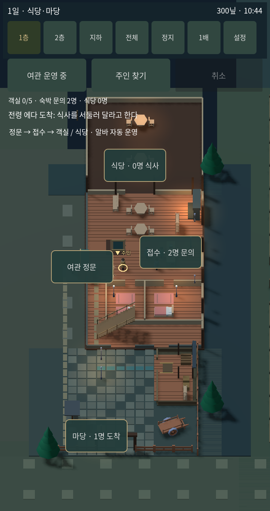
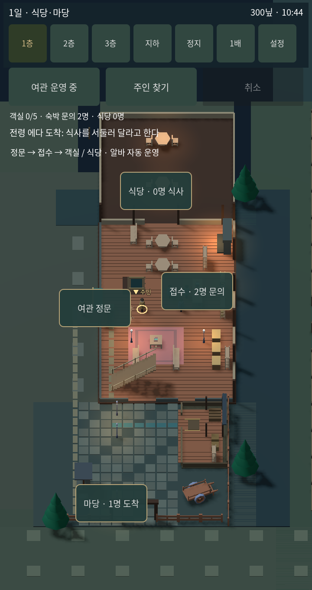
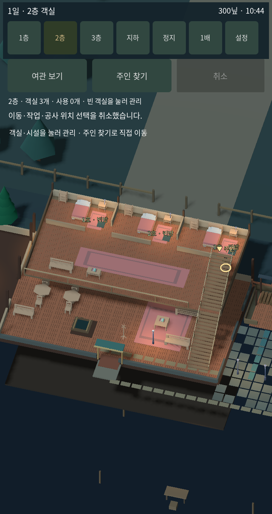
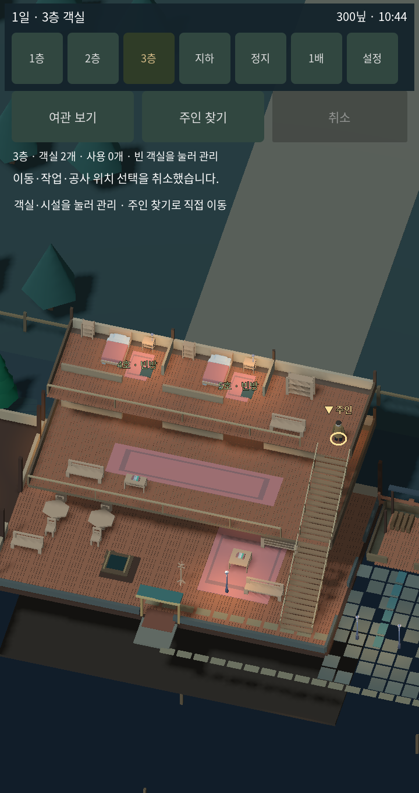

# 1.8.1 객실 전용 2·3층과 1층 공용 공간

| 층 | 구성 |
|---|---|
| 1층 | 정문, 로비 대기석, 접수대, 식당, 접수 뒤 열쇠·린넨 수납장과 보관함, 기존 전용 창고·마당 |
| 2층 | 1·2·3호 객실, 공용 홀과 긴 러그, 벤치·독서 테이블, 3층 계단 |
| 3층 | 4·5호 객실, 린넨장과 벤치, 2층으로 내려가는 계단 |
| 지하 | 기존 감옥·시설·땅굴 유지 |

1층 침대와 객실 칸막이를 제거했다. 총 객실은 기존 5개를 유지하며 2층 3개, 3층 2개로 배치했다. 수납함·열쇠장은 공간 연출용 가구이며 별도의 물품 인벤토리 기능을 추가한 것은 아니다.

## 연결한 동작

- 상단 3층 버튼을 추가했다. 주인은 1층→2층→3층, 3층→2층→1층→지하를 실제 경로로 이동한다. 기존 전체 보기는 설정에 남는다.
- 층에 도착하면 해당 층 객실을 한눈에 보여준다. 주인 찾기는 직접 추적으로 전환한다.
- 손님의 객실 배정·입실·퇴실과 청소 알바는 새 객실 위치와 두 구간 계단을 사용한다.
- 숙박 손님은 식사할 때 1층 식당의 빈 좌석으로 내려와 주문하고, 제공받은 뒤 자기 객실로 돌아간다. 만석이면 재시도한다.
- 기존 저장은 이용 중인 객실과 손님을 새 층으로 옮기고 객실 비밀 통로를 다시 연결한다. 진행 중이던 옛 객실 식사 주문은 식당 주문으로 재조정한다. 이미 보유한 돈과 객실 이용 관계는 유지한다.
- 3층 이동·수감 호송·도주와 객실 비밀 통로도 층 번호를 반영한다.

## 실제 화면 비교

720 × 1360, 새 게임 약 24초. 적용 전 화면은 수정 전에 실행해서 캡처했다. 적용 후 각 층 역시 실제 렌더러 캡처다. 이미지 생성 시안이 아니다. 문서용 WebP는 PNG 원본을 무손실 변환한 것이다.

| 1층 적용 전 | 1층 적용 후 |
|---|---|
|  |  |

| 2층 객실 3개 | 3층 객실 2개 |
|---|---|
|  |  |

## 확인과 한계

변경된 층 이동·실제 침대 수·객실 배정·3층 입퇴실·청소·식당 왕복·이전 저장 이관 등 집중 확인 19개 통과. 기존 모바일 조작 관련 19개도 통과했다. 실제 캡처를 열어 각 층의 객실 잘림과 아래층 연출, 글자 중첩을 확인하고 조정했다. 휴대폰 실기기 성능과 장시간 균형을 검증한 것은 아니다.
